# DSO202 Assignment 2: StatefulSets and Ingress (Traefik) for the Task Tracker

## Overview

In Assignment 1, I deployed my three-tier Task Tracker (frontend, backend and PostgreSQL) using Deployments, a separate PVC and a NodePort Service. In this assignment, I deployed the same app again using what we learned in Unit 2:

- **StatefulSet** for the database, with a **headless Service** and **volumeClaimTemplates**. This gives the database a fixed name, its own storage, and ordered start-up and scaling.
- **Ingress** with the **Traefik Ingress Controller** as the single entry point to the app. I used path-based routing, name-based virtual hosting and Traefik annotations.

I reused the same images from Assignment 1 without changing them:

| Tier | Image | Port | Assignment 1 | Assignment 2 |
|---|---|---|---|---|
| Frontend | `rynorbu11/dso202-frontend:1.0` | 8080 | Deployment + **NodePort** Service | Deployment + **ClusterIP** Service, reached through **Ingress** |
| Backend | `rynorbu11/dso202-backend:1.0` | 8080 | Deployment + ClusterIP Service | Deployment + ClusterIP Service, reached through **Ingress** |
| Database | `rynorbu11/dso202-db:1.0` | 5432 | Deployment + separate PVC + headless Service | **StatefulSet** + **volumeClaimTemplates** + **headless Service** |

The app is available at **http://ranjung.com** (full app) and **http://api.ranjung.com** (API only).

---

## Task 1: Cluster Setup

I needed to open the app from my Windows browser, so the Ingress Controller had to be reachable from my computer. A normal `kind create cluster` does not open any ports, so I created my cluster from `kind-cluster.yaml`. The `extraPortMappings` in that file open port **80** of the control-plane node on `127.0.0.1`.

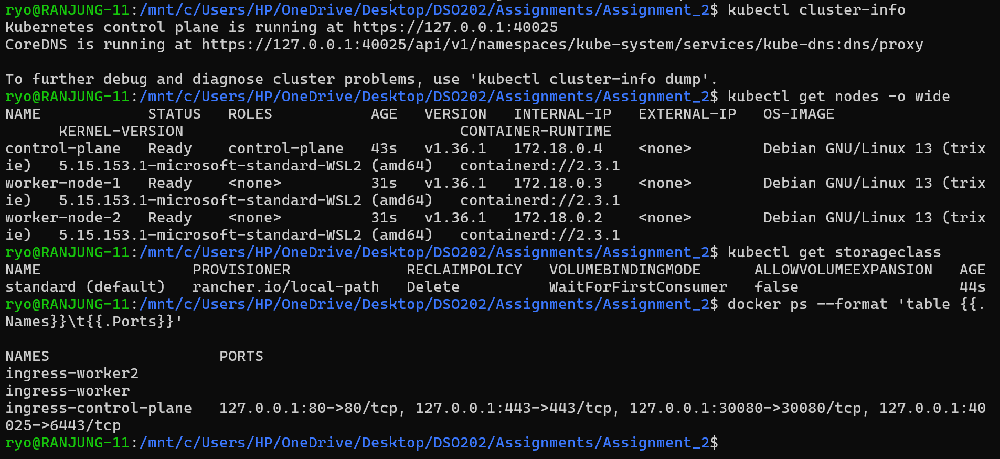

My cluster has three Ready nodes (`control-plane`, `worker-node-1`, `worker-node-2`) running Kubernetes v1.36.1. The `standard` StorageClass will create the database volumes automatically. `docker ps` shows that `ingress-control-plane` publishes `127.0.0.1:80 -> 80/tcp`, which is the port Traefik listens on.

---

## Task 2: Namespace, Quota, Secret and ConfigMap

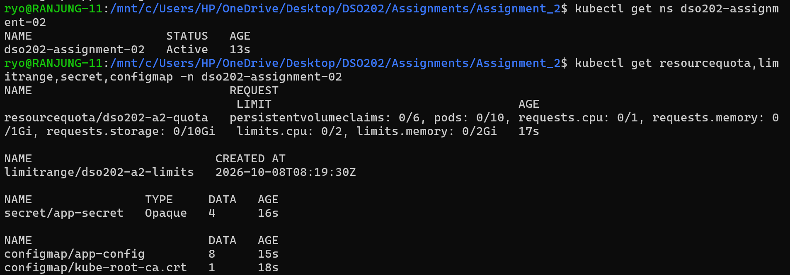

The namespace `dso202-assignment-02` is Active. The ResourceQuota limits the namespace to 10 pods, 6 PVCs and 10Gi of storage, and also limits CPU and memory. The LimitRange gives default CPU and memory values to any container that does not set its own. The Secret `app-secret` stores the database username and password, and the ConfigMap `app-config` stores the other settings.

I changed two ConfigMap values from Assignment 1:

- **`DB_HOST: "db-0.db-headless"`**: the backend now connects to the fixed DNS name of the database pod, instead of a normal Service name.
- **`BACKEND_URL: "."`**: the frontend calls `./api/tasks` on the same hostname it was loaded from. The Ingress sends `/api` to the backend, so the frontend and backend share one address and I don't need CORS.

---

## Task 3: Database as a StatefulSet

### 3.1 Why I used a StatefulSet

In Assignment 1 my database was a Deployment. It worked with one pod, but a Deployment treats all its pods as the same:

| | Deployment (A1) | StatefulSet (A2) |
|---|---|---|
| Pod name | random, e.g. `db-deployment-7d9f8-xk2p` | fixed, `db-0`, `db-1`, … |
| DNS | only the Service name | every pod gets its own name: `db-0.db-headless` |
| Storage | one PVC that I created by hand | one PVC **per pod**, created automatically |
| Start / stop order | all at once | in order: `db-0` → `db-1` → `db-2`, reverse when scaling down |
| After a restart | new name | **same name, same PVC** |

A database keeps data, and the backend needs to find it by a name that doesn't change, so a StatefulSet is the right choice. The frontend and backend don't keep any data, so I left them as Deployments.

### 3.2 Headless Service

I applied the headless Service **before** the StatefulSet. The StatefulSet uses `serviceName: db-headless` to give each pod its own DNS name.

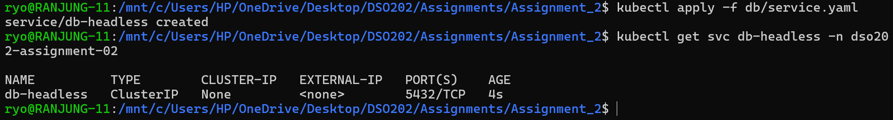

`CLUSTER-IP` is **None**. This means Kubernetes doesn't give the Service its own IP. A DNS lookup returns the pod's IP directly.

### 3.3 StatefulSet with volumeClaimTemplates

The readiness probe matters for ordered start-up. With `OrderedReady`, Kubernetes waits until a pod is **Ready** before it creates the next one. Without the probe, a pod would count as Ready as soon as it was Running, even if Postgres was still starting.

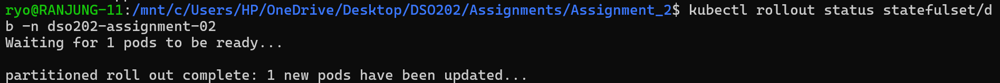

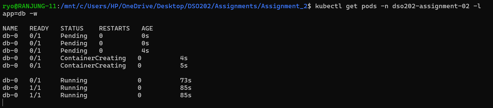

The pod `db-0` went from `Pending` (waiting for its disk) to `ContainerCreating`, then `Running 0/1`. It became `1/1` only after `pg_isready` succeeded.

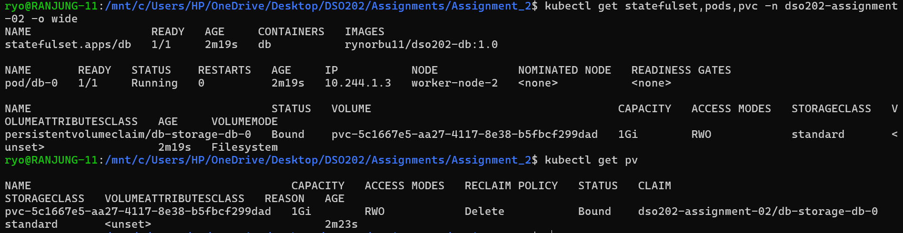

The pod is called **`db-0`**, not a random name. The PVC **`db-storage-db-0`** was created automatically from the template, so I didn't have to write a PVC file like in Assignment 1.

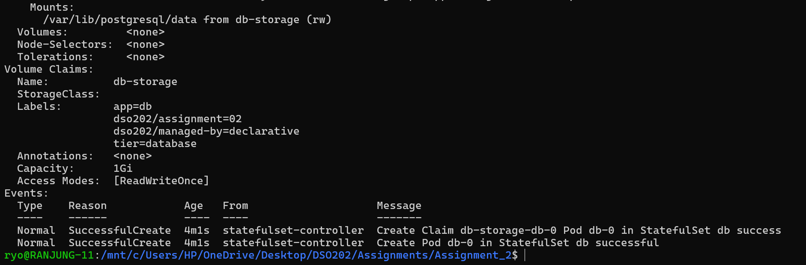

The events show that Kubernetes first ran **`Create Claim db-storage-db-0`** and then **`Create Pod db-0`**, so the disk was ready before the pod started.

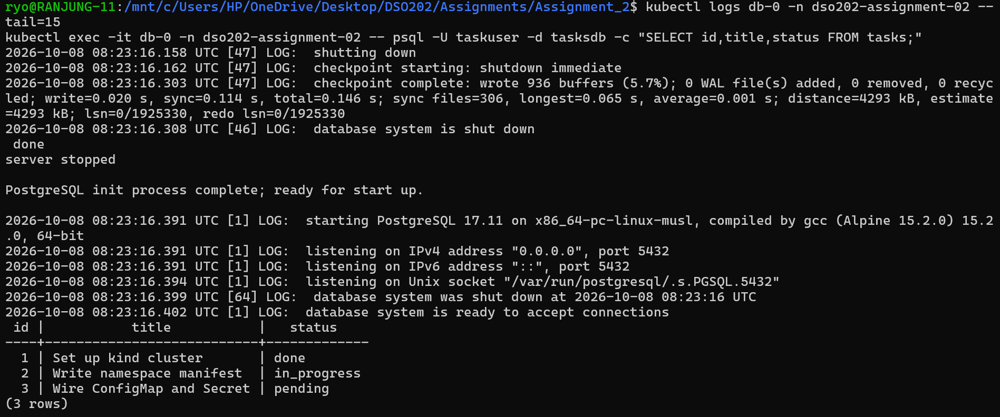

PostgreSQL started on the empty disk, ran `01-init.sql`, and the `tasks` table has the 3 starting rows.

### 3.4 Stable network identity

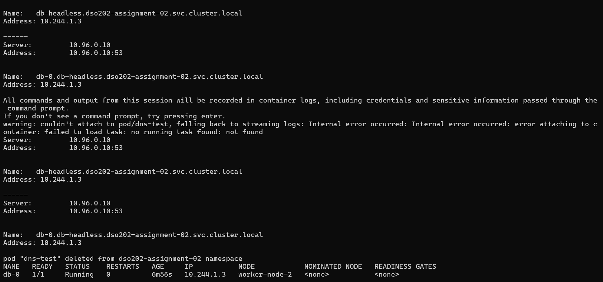

`db-0.db-headless` resolves **directly to the pod IP `10.244.1.3`**, the same IP shown by `kubectl get pod -o wide`. The name `db-0.db-headless` always belongs to this pod, so I can safely use it as `DB_HOST` in the backend.

---

## Task 4: Backend and Frontend

The frontend and backend are still **Deployments** because they don't store data. The difference from Assignment 1 is that **both Services are now `ClusterIP`**. I don't need a NodePort any more, because the Ingress is the only way in.

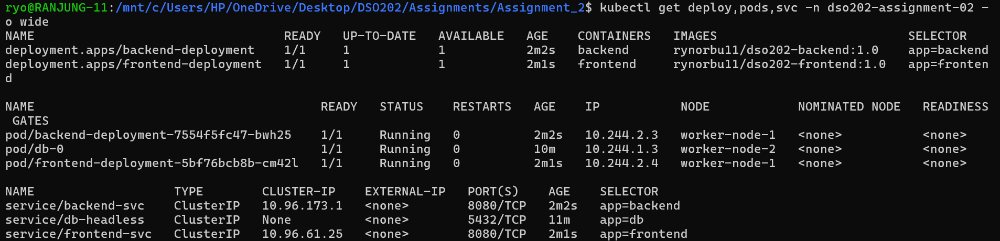

All three pods are `1/1 Running` on the **worker nodes**, not on the control-plane: the frontend and backend are on `worker-node-1`, and `db-0` is on `worker-node-2`. `backend-svc` and `frontend-svc` are `ClusterIP`, so they can't be reached from outside the cluster without the Ingress. `db-headless` has `CLUSTER-IP None`.

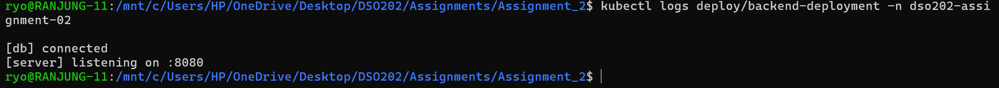

The backend log shows `[db] connected` and `[server] listening on :8080`. This shows the backend found the database using the name `db-0.db-headless`.

---

## Task 5: Ingress Controller Setup

### 5.1 First try: NGINX Ingress Controller

I first tried the NGINX Ingress Controller, but its pod never started:

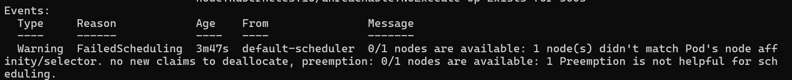

The first error was **FailedScheduling: didn't match Pod's node affinity/selector**. The kind version of NGINX only runs on a node with the label `ingress-ready=true`, and my nodes didn't have it.

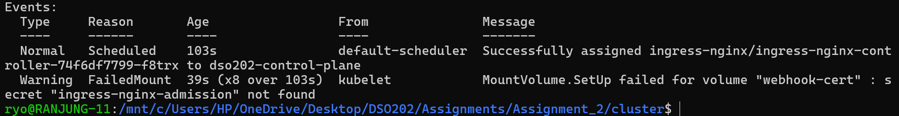

After that, it failed with **`secret "ingress-nginx-admission" not found`**, because the admission webhook job hadn't finished.

Because of these problems, I switched to **Traefik**. Traefik is easy to install with a few YAML files, and it can be configured through annotations.

### 5.2 Traefik Ingress Controller

**Step 1: Install the Traefik CRDs.** I need these for the `Middleware` object in Task 7.

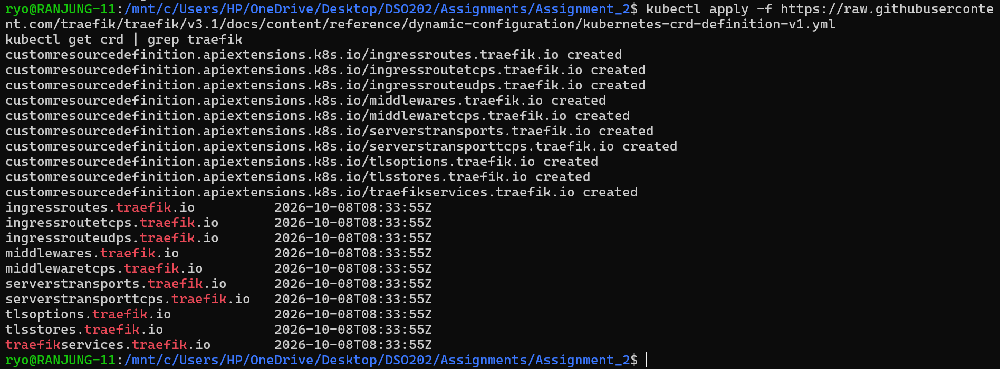

**Step 2: Deploy the controller.** `traefik/rbac.yaml` gives Traefik permission to read Ingresses, Services and Middlewares. `traefik/traefik.yaml` creates the IngressClass and the Traefik Deployment.

The control-plane node is the only node where kind opens port 80 to my computer, so Traefik has to run there. I set this up in the Deployment with four settings:

- **`nodeSelector: node-role.kubernetes.io/control-plane`** tells Kubernetes to put Traefik on the control-plane node.
- **A toleration** lets it run there. By default, the control-plane node doesn't accept normal pods.
- **`hostPort: 80`** binds port 80 directly on that node, so requests from my computer reach Traefik.
- **`strategy: Recreate`** removes the old Traefik pod before starting a new one, because only one pod can use port 80 on the node.

This is the same placement problem that broke my NGINX install, but this time I solved it myself.

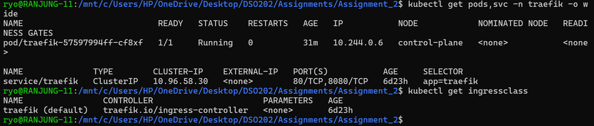

The Traefik pod is `1/1 Running` on the **`control-plane`** node. Its Service has port `80` for web traffic and `8080` for the Traefik dashboard. The IngressClass `traefik` is marked as `(default)`, so my Ingress uses this controller.

### 5.3 How the work is split between the nodes

In my cluster, the **Ingress Controller runs on the control-plane node**, and the **application runs on the worker nodes**:

| Node | What runs there | Its job |
|---|---|---|
| `control-plane` | Traefik (Ingress Controller) | Receives every request from my computer on port 80 and decides where it should go |
| `worker-node-1` | frontend and backend pods | Serve the web page and handle the API requests |
| `worker-node-2` | `db-0` (database) pod | Stores the tasks in PostgreSQL |

So the control-plane node is only the **front door**. It accepts the traffic and passes it on, and the worker nodes do the actual work. This works because every pod can reach every other pod over the cluster network, whichever node it's on. Keeping my app off the control-plane also means the node that runs Kubernetes itself isn't busy serving my app. If I add more replicas later, Kubernetes can spread them across both workers.

---

## Task 6: Ingress Resource

### 6.1 The Ingress manifest

`Ingress/ingress.yaml` has one Ingress called `dso202-ingress`. It uses the `traefik` IngressClass and has two rules, one for each hostname:

| Hostname | Path | Goes to |
|---|---|---|
| `ranjung.com` | `/api` | `backend-svc` (port 8080) |
| `ranjung.com` | `/` | `frontend-svc` (port 8080) |
| `api.ranjung.com` | `/` | `backend-svc` (port 8080) |

**How it works:**

- **Path-based routing:** On `ranjung.com`, the path decides where the request goes. `/api` goes to `backend-svc`, and everything else goes to `frontend-svc`. Traefik checks the longer path `/api` first, so it doesn't get caught by `/`.
- **Name-based virtual hosting:** `ranjung.com` and `api.ranjung.com` use the same IP (`127.0.0.1`) and the same port (80). Traefik looks at the `Host` header to choose the rule. `ranjung.com` serves the whole app, and `api.ranjung.com` serves only the API.

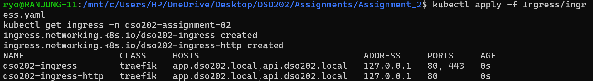

The Ingress uses the `traefik` class, serves `ranjung.com,api.ranjung.com` on port 80, and has the address `127.0.0.1`.

### 6.2 Hostname resolution

Both hostnames have to point to my own computer. I added this line to the Windows hosts file (`C:\Windows\System32\drivers\etc\hosts`, edited as Administrator) for the browser, and to `/etc/hosts` in WSL for `curl`:

```
127.0.0.1    ranjung.com api.ranjung.com
```

---

## Task 7: Traefik Annotations

A normal Ingress can only describe hosts, paths and backends. Anything else is controller-specific, so I configured it with annotations that only Traefik understands:

| Annotation | Value | What it does |
|---|---|---|
| `traefik.ingress.kubernetes.io/router.entrypoints` | `web` | Makes the route listen on Traefik's `web` entrypoint (port 80) |
| `traefik.ingress.kubernetes.io/router.middlewares` | `dso202-assignment-02-security-headers@kubernetescrd` | Attaches my `security-headers` Middleware to the route |

The Middleware is a Traefik object defined in `Ingress/middleware.yaml`. It adds these headers to every response:

- `X-Frame-Options: DENY`: stops other websites from showing my app inside a frame
- `X-Content-Type-Options: nosniff`: stops the browser from guessing the file type
- `Referrer-Policy: no-referrer`: doesn't send my URL to other sites
- `X-Served-By: traefik-dso202`: a custom header, so I can easily see that Traefik handled the request

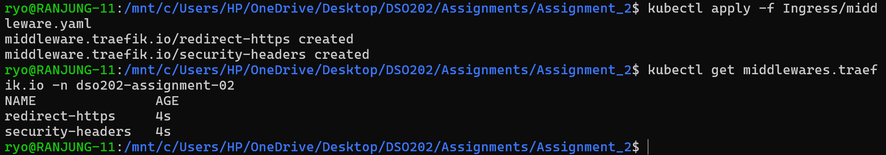

The `security-headers` Middleware exists in my namespace. The `curl -I` output shows the extra headers (`X-Frame-Options`, `X-Content-Type-Options`, `X-Served-By`), which proves Traefik applied the annotation.

---

## Task 8: Testing the Ingress

### 8.1 Name-based virtual hosting

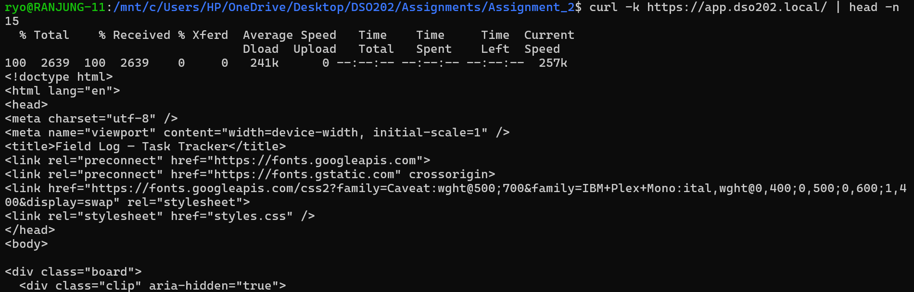

`http://ranjung.com/` returns the HTML of the *Field Log – Task Tracker* frontend. `http://api.ranjung.com/api/status` returns `{"status":"ok","db":"connected"}` from the backend. Both hostnames use the same IP and port, but Traefik sends them to different Services.

### 8.2 Path-based routing

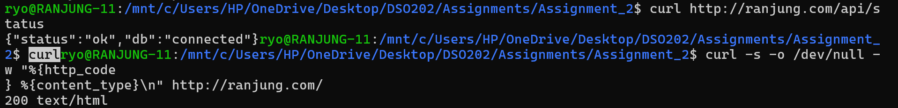

On the same hostname, `/api/status` returns JSON from the backend, and `/` returns `200 text/html` from the frontend. The path decides which Service handles the request.

### 8.3 Testing in the browser

I opened **http://ranjung.com** in my browser and the app loaded through the Ingress:

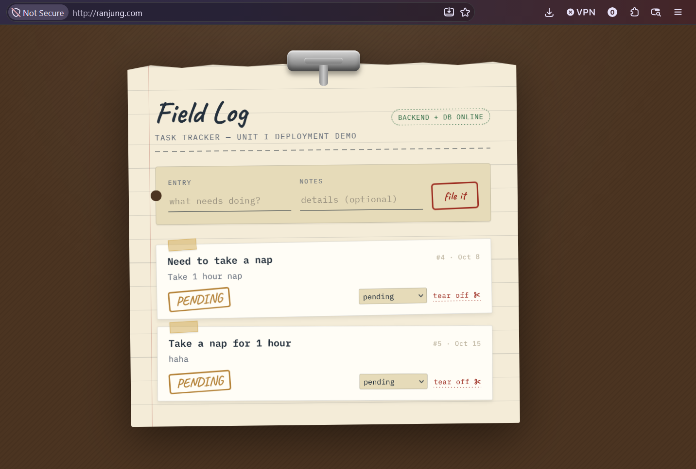

The status shows **BACKEND + DB ONLINE**. The frontend called `/api/status` on the same hostname, the Ingress sent it to the backend, and the backend reached PostgreSQL at `db-0.db-headless`.

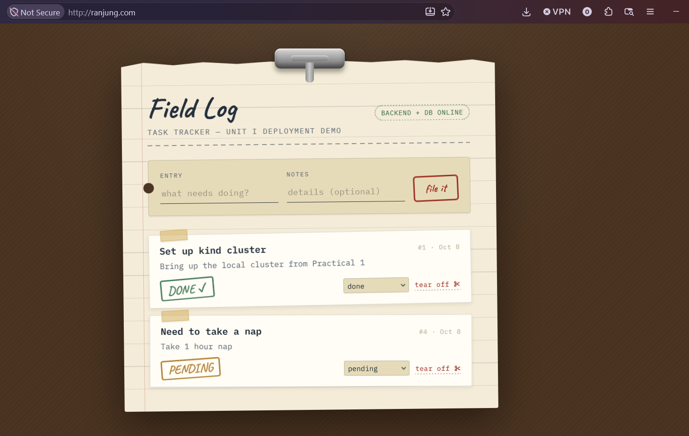

Then I tested adding and deleting tasks. I added task **#4 "Need to take a nap"** and deleted tasks #2 and #3. Each action sends a request to `http://ranjung.com/api/tasks`, and the `/api` rule sends it to the backend. The new task got id 4, which shows the database kept counting from its saved data.

### 8.4 Why the browser says "Not Secure"

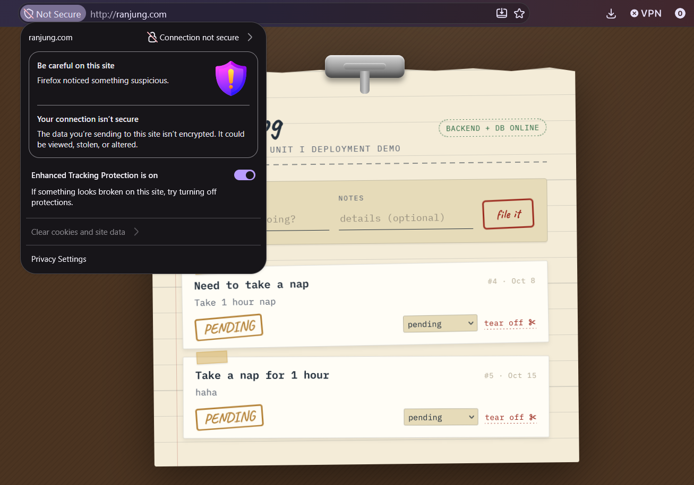

Firefox shows **"Not Secure"** next to the address, and **"Your connection isn't secure"** when I click it. This is expected, because I didn't set up a TLS certificate. My app runs on plain **HTTP** (`http://ranjung.com`), not **HTTPS**, so the data between the browser and Traefik isn't encrypted. The app still works normally, as the **BACKEND + DB ONLINE** status and my tasks show.

For a real website, I would add a TLS certificate to the Ingress so the site uses HTTPS. The browser would then show the connection as secure. For this assignment I kept the setup on plain HTTP and focused on the Ingress routing.

---

## Task 9: StatefulSet Persistence (Deleting the Pod)

To check that the database keeps its name and its data, I deleted the `db-0` pod and watched Kubernetes recreate it:

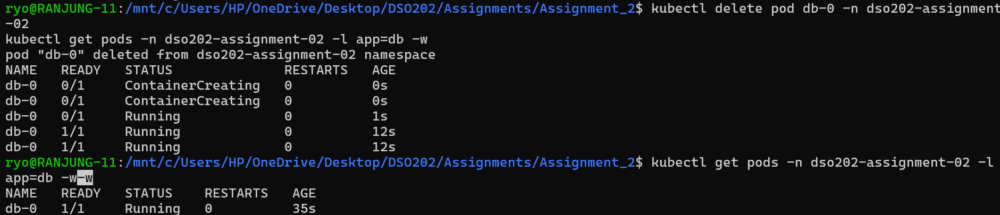

Kubernetes recreated the pod straight away with the **same name, `db-0`**. A Deployment would have given it a new random name. The new pod was `1/1 Running` after about 12 seconds.

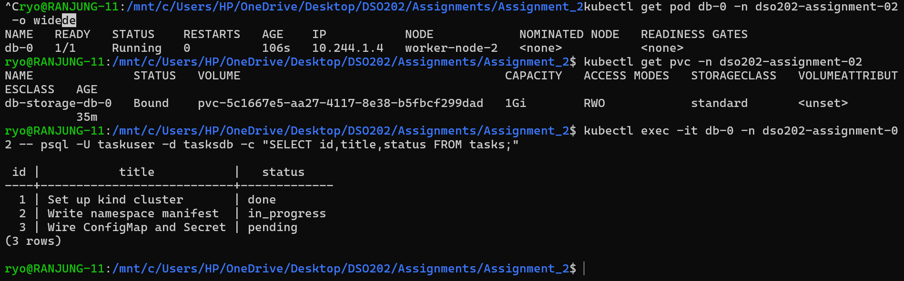

The pod's **IP changed** from `10.244.1.3` to `10.244.1.4`, but that doesn't matter, because the backend uses the name `db-0.db-headless`, which now points to the new IP. The pod reattached to the **same PVC, `db-storage-db-0`**, and all the rows are still in the `tasks` table. The data survived the pod being deleted.

---

## Task 10: Ordered Scaling and Updates

### 10.1 Scaling up from 1 to 3

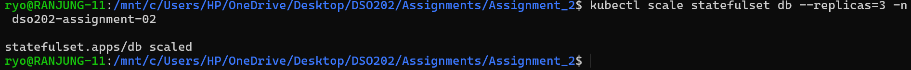

I scaled the StatefulSet to 3 replicas and watched the pods in a second terminal:

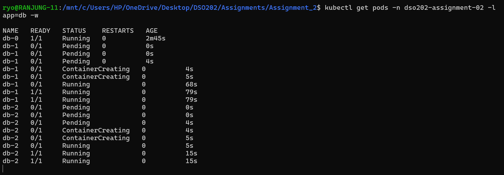

This shows `OrderedReady` working. **`db-1`** was created first and went `Pending` → `ContainerCreating` → `Running 0/1` → `Running 1/1`. Only **after `db-1` was Ready** did Kubernetes create **`db-2`**. The pods never started at the same time.

### 10.2 Rolling update

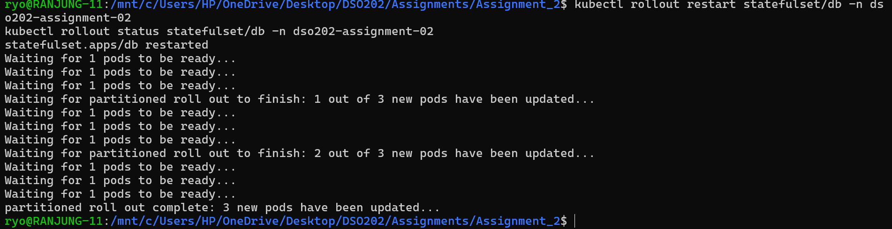

The update replaced the pods **one at a time** ("1 out of 3", "2 out of 3", then all 3), waiting for each pod to be Ready before moving to the next. A StatefulSet updates in reverse order (`db-2` → `db-1` → `db-0`), so `db-0`, the one the backend uses, is updated last.

### 10.3 Scaling down from 3 to 1

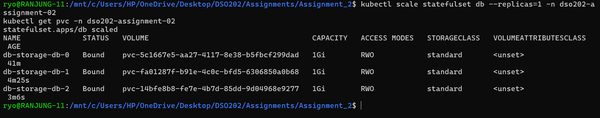

The pods were removed in **reverse order** (`db-2` first, then `db-1`). The PVCs **`db-storage-db-1` and `db-storage-db-2` are still `Bound`**, because `whenScaled: Retain` keeps them. If I scale up again, `db-1` and `db-2` will reuse their old disks.

> **Note:** `db-1` and `db-2` are separate PostgreSQL databases, not copies of `db-0`. A StatefulSet gives each pod its own name and disk, but it doesn't copy data between them. That needs PostgreSQL replication. This is why my backend always connects to `db-0.db-headless`.

---

## Reflection

**What I learned about StatefulSets**

Before this assignment, I thought a Deployment was enough for everything. My database worked as a Deployment in Assignment 1, so I didn't see a problem. Now I understand the difference. A Deployment treats all its pods as the same. If a pod dies, the new one gets a random name, and Kubernetes doesn't care which pod is which. That's fine for my frontend and backend, because they don't keep any data.

A database is different. It keeps data, and the backend needs to find it by a name that doesn't change. With a StatefulSet, my database pod is always called `db-0`, it always has the DNS name `db-0.db-headless`, and it always gets its own disk (`db-storage-db-0`) back. When I deleted the pod, the new one had a different IP but the same name, the same disk, and all my tasks were still there. Seeing this myself made it much clearer than just reading about it.

I also learned why the **headless Service** is needed. A normal Service has one IP and spreads traffic across all the pods. A headless Service (`clusterIP: None`) gives each pod its own DNS name instead, which is what a database needs. With **volumeClaimTemplates**, I didn't have to write a PVC by hand. The StatefulSet made one disk for each pod, so when I scaled to 3 pods, I got 3 disks.

The scaling test showed me **ordered deployment**. `db-2` didn't start until `db-1` was ready, and when I scaled down, the pods were removed in reverse order while their disks were kept. I also learned that a StatefulSet does **not** copy data between pods: `db-1` and `db-2` were separate, empty databases.

**What I learned about Ingress**

In Assignment 1, I opened the frontend with a NodePort (port 30080). That works, but in a real system you can't open a new port for every service. With Ingress there is **one entry point** (port 80), and the Ingress Controller decides where each request goes:

- by **path**: `/api` goes to the backend and everything else goes to the frontend,
- by **hostname**: `ranjung.com` and `api.ranjung.com` use the same IP and port but reach different services.

I also saw how the work is split between the nodes. Traefik runs on the control-plane node and receives all the traffic, then sends each request to the frontend or backend pods running on the worker nodes. The control-plane is only the entry point, and the workers do the real work.

I also learned that an Ingress is only a set of rules. Nothing happens until an **Ingress Controller** is running to read them. Extra features, like adding security headers, are set with **annotations** that only that controller understands. That's why my annotations start with `traefik.ingress.kubernetes.io/`.

**Challenges I faced**

The hardest part was setting up the Ingress Controller. NGINX failed twice: first because my node didn't have the `ingress-ready=true` label, and then because a webhook secret was missing. I moved to Traefik and learned that on kind, the controller has to run on the control-plane node, because that's the only node where port 80 is open to my computer. I fixed this with a `nodeSelector`, a toleration and `hostPort`.

I also made some smaller mistakes that took time to find:

- My `DB_HOST` was `db-0.db-svc`, but my headless Service was called `db-headless`, so the backend couldn't reach the database. The names have to match exactly.
- The frontend was calling `/api/api/tasks` because `/api` was added twice.
- I applied the Traefik Deployment before its ServiceAccount, so no pod was created. `kubectl describe` on the ReplicaSet showed me the error.
- When I updated Traefik, the new pod got stuck in `Pending` because the old pod was still using port 80 on the node. I fixed it by deleting the old pod and changing the Deployment strategy to `Recreate`, so the old pod is removed before the new one starts.
- On Windows, my browser said "server not found" for `ranjung.com` even though `curl` worked in WSL. The browser uses the Windows hosts file, not the WSL one, so I had to add the hostname there too (as Administrator).

From these problems, I learned to always check `kubectl describe` and `kubectl logs` first, because the error message usually tells you exactly what's wrong.

---

## Conclusion

In this assignment, I deployed my Assignment 1 Task Tracker again using Unit 2 concepts:

- The **database** runs as a **StatefulSet** with a fixed pod name (`db-0`), a fixed DNS name from a **headless Service** (`db-0.db-headless`), and its own disk from **volumeClaimTemplates**. When I deleted the pod, it came back with the same name, disk and data. When I scaled, pods were created in order, updated one at a time and removed in reverse order, and their disks were kept.
- The **Traefik Ingress Controller** replaced the NodePort as the single entry point. It runs on the **control-plane node** and sends the traffic to the frontend, backend and database pods on the **worker nodes**. One Ingress does **path-based routing** (`/api` and `/`) and **name-based virtual hosting** (`ranjung.com` and `api.ranjung.com` on the same IP and port). **Traefik annotations** choose the entrypoint and add security headers through a Middleware.

The app works in the browser at **http://ranjung.com**: the frontend, backend and database all talk to each other through the Ingress and the fixed DNS name.
