# DSO202 Assignment 3: Deploying the Task Tracker with Kustomize and Helm

**Environment:** Windows 11 with WSL (Ubuntu), kind cluster `ingress` (Kubernetes v1.36.1, 1 control-plane and 2 worker nodes), kubectl (with built-in Kustomize) and Helm 3.18

---

## Introduction

In Assignment 1, I deployed a three-tier **Task Tracker** application on Kubernetes. It has three parts:

- a **frontend** (nginx) that shows the web page
- a **backend** (Node.js / Express) that provides the API
- a **database** (PostgreSQL) that stores the tasks

In that assignment I wrote every YAML file by hand and applied them one by one with `kubectl apply -f`. It worked, but it had some problems:

- The namespace was written inside **every** file. To make a second environment (for example, a production copy), I would have to copy and edit all the files.
- Copied files can easily get out of sync. If I fix something in one copy, I might forget the other.
- The database password was stored in `secret.yaml` and only base64-encoded, which is easy to decode.
- When I changed the ConfigMap, the running Pods did not restart, so they kept the old settings.
- There was no version number for the whole app and no easy way to undo a bad change.

In Unit 4 we learned two tools that solve these problems:

| Tool | Type | Main idea |
|---|---|---|
| **Kustomize** | Configuration management | Keep the shared YAML once in a **base**, and write only the differences for each environment in an **overlay**. |
| **Helm** | Package management | Turn the app into a **chart** (a package) with templates and settings, then install, upgrade, roll back and share it as one versioned unit. |

### Aim

To deploy the Assignment 1 Task Tracker again, first with **Kustomize** and then with **Helm**, each in a **dev** and a **prod** environment. Then to compare the two tools using my own results.

### Objectives

- Restructure the Assignment 1 manifests into a Kustomize base with dev and prod overlays.
- Use Kustomize generators, patches and transformers, and show that a config change restarts the Pods automatically.
- Build a Helm chart for the same app with templates, values files, input validation and a test.
- Practise the Helm release lifecycle: install, upgrade, history, rollback, test and package.
- Compare Kustomize and Helm based on what I observed.

### Application and environments

| Tier | Image | Port | Service type |
|---|---|---|---|
| Frontend | `rynorbu11/dso202-frontend:1.0` | 8080 | NodePort 30080 in dev, ClusterIP in prod |
| Backend | `rynorbu11/dso202-backend:1.0` | 8080 | ClusterIP (only reachable inside the cluster) |
| Database | `rynorbu11/dso202-db:1.0` | 5432 | Headless Service + PersistentVolumeClaim |

I used four separate namespaces, so the deployments never mixed:

| Tool | dev | prod |
|---|---|---|
| Kustomize | `dso202-a3-kust-dev` | `dso202-a3-kust-prod` |
| Helm | `dso202-a3-helm-dev` (release `tt-dev`) | `dso202-a3-helm-prod` (release `tt-prod`) |

---

## Environment Setup

For this assignment I used the same kind cluster from Assignment 2, called `ingress`. It already maps port 30080 on my computer to NodePort 30080 in the cluster, so the frontend can be opened at `http://localhost:30080`. I switched to the `kind-ingress` context and checked that all the nodes were ready. Then I loaded the three Assignment 1 images into the cluster with `kind load docker-image`, so the Pods could start without downloading anything.

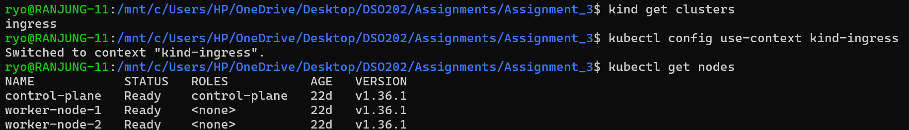

*Figure 1: Checking the cluster.* `kind get clusters` shows my `ingress` cluster. After switching to the `kind-ingress` context, `kubectl get nodes` shows all three nodes in the `Ready` state.

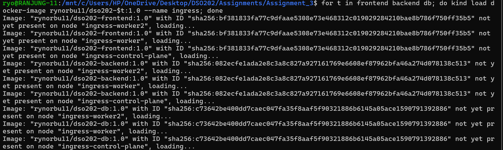

*Figure 2: Loading the images into the cluster.* The frontend, backend and database images were copied into every node, so Kubernetes does not need to download them from Docker Hub. (The names `ingress-worker` and so on are the node containers that kind creates.)

---

# Part A: Kustomize

## A.1 Organising the Files

Kustomize works with a base and overlays. The base holds everything that is shared, and each overlay holds only what is different for one environment. I created the folder structure below and copied my Assignment 1 manifests into the `base` folder.

Then I made three small changes to the base files:

1. I removed the `namespace:` line from every file, because each overlay now sets the namespace.
2. I deleted `configmap.yaml` and `secret.yaml`. Kustomize now **generates** them from a list of values (`configMapGenerator`) and from a `.env` file (`secretGenerator`).
3. I set the database Deployment to `strategy: Recreate`. The database volume can only be used by one Pod at a time, so the old Pod must stop before the new one starts.

## A.2 Building the Base

Before deploying anything, I built the base on my own computer with `kubectl kustomize kustomize/base`. This command only prints the final YAML and does not change anything in the cluster, so it is a safe way to check the output.

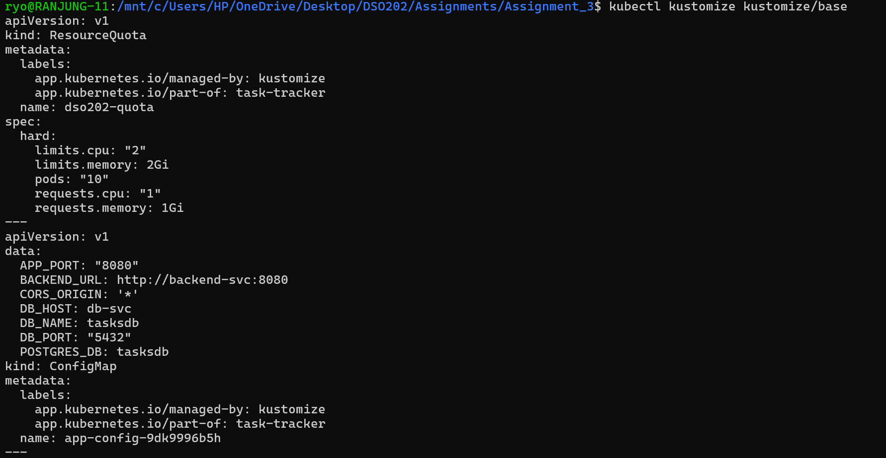

*Figure 3: Rendering the base.* Two things to notice:

- Kustomize added the labels `part-of: task-tracker` and `managed-by: kustomize` to every object.
- The generated ConfigMap is named `app-config-9dk9996b5h`. The extra letters at the end are a **hash** of its contents. If the contents change, the name changes too.

## A.3 Writing the Dev and Prod Overlays

The dev and prod overlays each point to `../../base` and add only what is different, so I did not copy any of the base files. I wrote one patch file for dev and two for prod. The table below shows what each environment changes.

| Setting | dev | prod | How Kustomize does it |
|---|---|---|---|
| Namespace | `dso202-a3-kust-dev` | `dso202-a3-kust-prod` | `namespace:` field |
| Environment label | `dev` | `prod` | `labels:` field |
| Frontend Service | NodePort 30080 | ClusterIP | patch file (strategic merge) |
| Frontend / backend replicas | 1 / 1 | 2 / 2 | `replicas:` field |
| Backend CPU (request / limit) | 100m / 250m | 150m / 300m | patch file (strategic merge) |
| Database storage | 1Gi | 2Gi | patch file (JSON 6902) |
| `CORS_ORIGIN` setting | `*` | `http://localhost:8081` | `configMapGenerator` with `behavior: merge` |

I used both kinds of Kustomize patch:

- A **strategic merge** patch looks like a small piece of a normal Kubernetes object. It is easy to read.
- A **JSON 6902** patch is a list of exact operations, such as "replace the value at `/spec/resources/requests/storage` with `2Gi`".

**A design decision.** Kustomize has a `namePrefix` option that could rename objects, for example `backend-svc` to `dev-backend-svc`. I chose not to use it. Kustomize does not change text inside ConfigMap values, so settings like `DB_HOST=db-svc` would still point to the old names and the app would break. Using a different **namespace** for each environment keeps the names the same and avoids this problem.

## A.4 Checking the Output Before Deploying

I built both overlays and saved the output to two files with `kubectl kustomize`. Then I searched them for the important lines with `grep` and compared the two files with `diff`. This let me confirm that each environment had the right settings before anything reached the cluster.

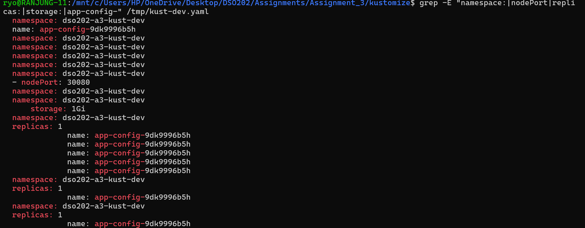

*Figure 4: Dev output.* Every object is in the `dso202-a3-kust-dev` namespace. The frontend uses `nodePort: 30080`, the database volume is `1Gi`, and all Deployments have 1 replica.

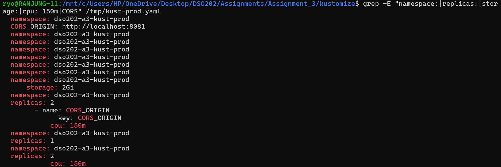

*Figure 5: Prod output.* The namespace is `dso202-a3-kust-prod`, `CORS_ORIGIN` is `http://localhost:8081`, storage is `2Gi`, replicas are `2`, and the backend CPU request is `150m`. These are the prod overlay's changes.

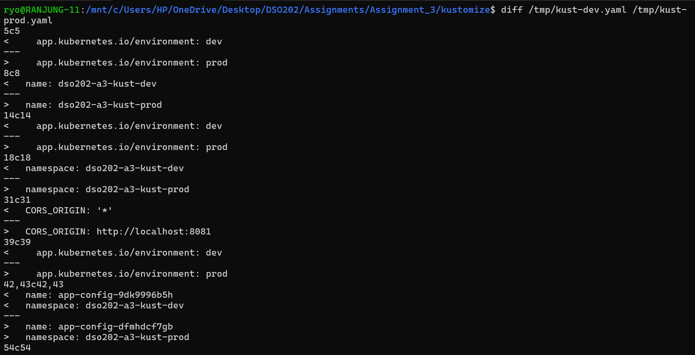

*Figure 6: Comparing dev and prod.* The `diff` shows that only a few lines are different: the environment label, the namespace and `CORS_ORIGIN`. Because the prod ConfigMap has different content, it also gets a different hash name (`app-config-dfmhdcf7gb` instead of `app-config-9dk9996b5h`). Everything else comes from the same base.

## A.5 Deploying Dev

My first `kubectl diff -k overlays/dev` failed with a "namespace not found" error. This happened because `kubectl diff` compares against what is already in the cluster, and the namespace did not exist yet. I created the namespace from the overlay's `namespace.yaml` and ran the diff again. Then I deployed dev with `kubectl apply -k overlays/dev` and watched the Pods start.

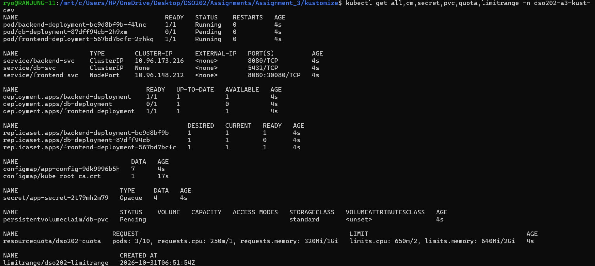

*Figure 7: Right after applying.* All the objects were created: the Deployments, the Services (the frontend is NodePort `8080:30080`), the generated ConfigMap and Secret, the quota and the volume claim. For a few seconds, the database Pod and its volume were `Pending` while kind created the storage. The quota already shows how much is used (3 of 10 Pods).

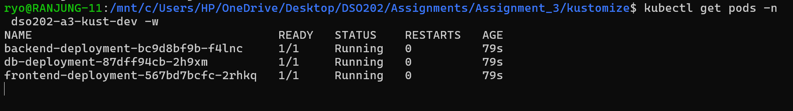

*Figure 8: All Pods running.* About a minute later, all three Pods were `Running`.

## A.6 Testing Dev

Once dev was running, I tested the whole app. I opened the frontend in my browser. The backend is only reachable inside the cluster, so I port-forwarded it to `localhost:8080` and tested its API with `curl`. I checked the backend status, then created, read and updated a task.

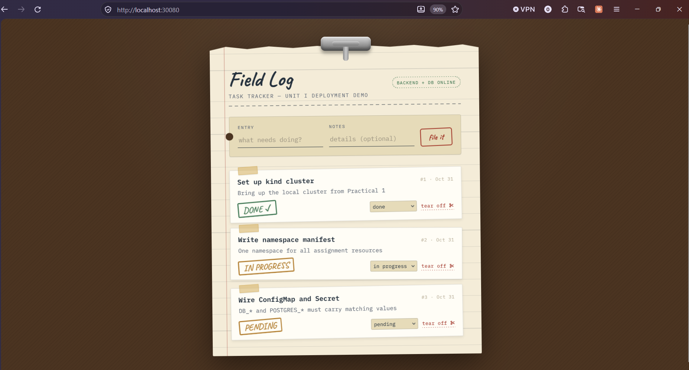

*Figure 9: The frontend in the browser.* The app opens at `http://localhost:30080`, and the badge says **BACKEND + DB ONLINE**. This works because the backend port-forward was running on port 8080, and my computer's hosts file (set up in Assignment 1) points the name `backend-svc` to my own machine.

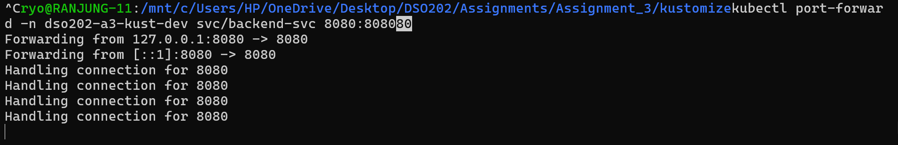

*Figure 10: Port-forwarding the backend* from `localhost:8080` to the `backend-svc` Service.

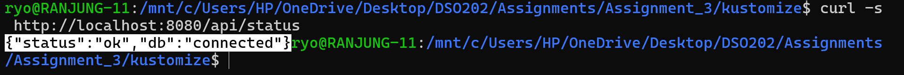

*Figure 11: Backend health check.* `/api/status` returns `"status":"ok","db":"connected"`. The backend reached the database using the settings from the generated ConfigMap and Secret.

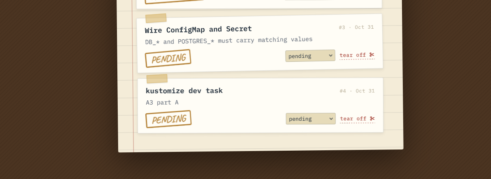

*Figure 12: Create.* I added a new task, "kustomize dev task", and it shows up in the app as task #4 with status `PENDING`.

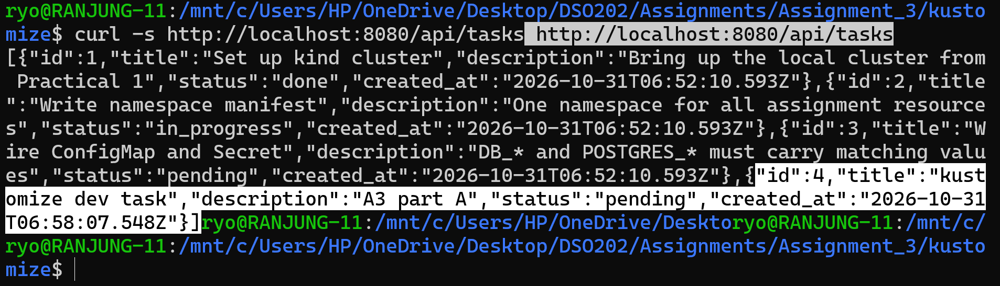

*Figure 13: Read.* `GET /api/tasks` returns the three starting tasks plus my new task #4.

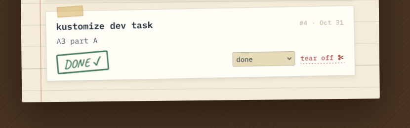

*Figure 14: Update.* I changed task #4 to `done`, and the app shows the `DONE ✓` stamp.

## A.7 Checking Labels and Generated Names

I also checked that the labels from the base and the overlay were applied, and that the Deployments use the generated ConfigMap name with the hash. I listed the Deployments with their labels, listed the ConfigMap and Secret, and printed the ConfigMap name used inside the backend Deployment.

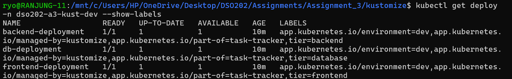

*Figure 15: Labels on the Deployments.* Every Deployment has `environment=dev` from the overlay, and `part-of=task-tracker` and `managed-by=kustomize` from the base. I never added these labels by hand.

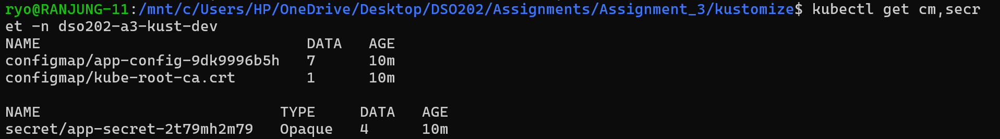

*Figure 16: Generated ConfigMap and Secret.* Both have hash endings in their names (`app-config-9dk9996b5h` and `app-secret-2t79mh2m79`).

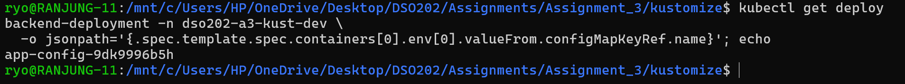

*Figure 17: The Deployment uses the hashed name.* The backend Deployment refers to `app-config-9dk9996b5h`. Kustomize filled in this name automatically; I only wrote `app-config` in my files.

## A.8 A Config Change Restarts the Pods Automatically

In Assignment 1, changing the ConfigMap did not restart the Pods, so they kept using the old values. I tested the same kind of change with Kustomize. First, I noted the current ConfigMap and Pod names. Then I added a dev-only `CORS_ORIGIN` value to the dev overlay and previewed the change with `kubectl diff`. Finally, I applied it and checked the ConfigMaps and Pods again.

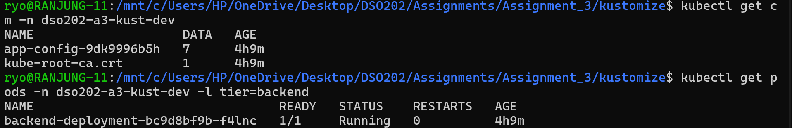

*Figure 18: Before the change.* There is one ConfigMap (`app-config-9dk9996b5h`), and the backend Pod has been running for over 4 hours.

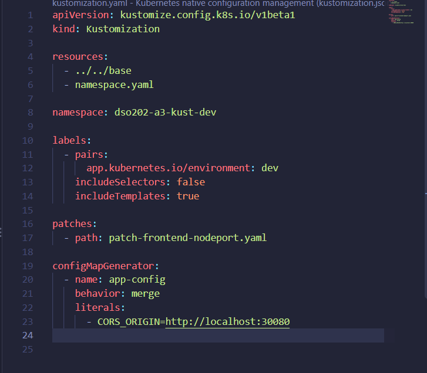

*Figure 19: The change.* In the dev overlay, I changed one setting: `CORS_ORIGIN=http://localhost:30080`.

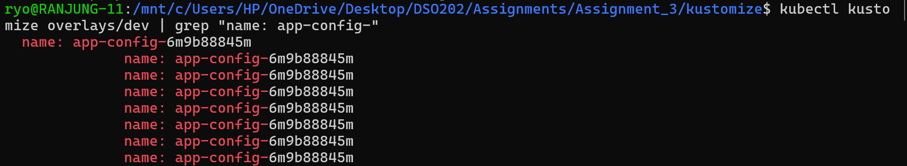

*Figure 20: New ConfigMap name.* Because the content changed, Kustomize gave the ConfigMap a new name, `app-config-6m9b88845m`, and updated every reference to it.

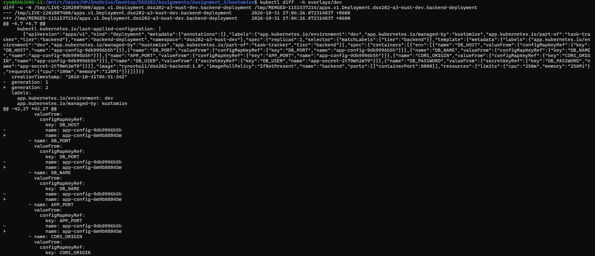

*Figure 21: Preview of the change.* `kubectl diff` shows the Deployment's references changing from the old name (`-`) to the new name (`+`). A changed Deployment means Kubernetes will start new Pods.

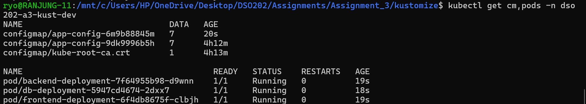

*Figure 22: After applying.* There are now two ConfigMaps, the new one and the old one. All three Pods have new names and are only seconds old, so they were replaced automatically because they all use this ConfigMap.

> **Key result:** with Kustomize, a configuration change automatically rolls out new Pods. I did not need to run `kubectl rollout restart`, which fixes one of the main problems from Assignment 1.

## A.9 Deploying and Testing Prod

Prod uses the same base, but with more replicas, more CPU, a bigger volume and a ClusterIP frontend. I created the prod namespace, previewed and applied the prod overlay, and checked the objects, the volume size and the quota. To test prod, I port-forwarded the frontend to port 8081 and the backend to port 8082.

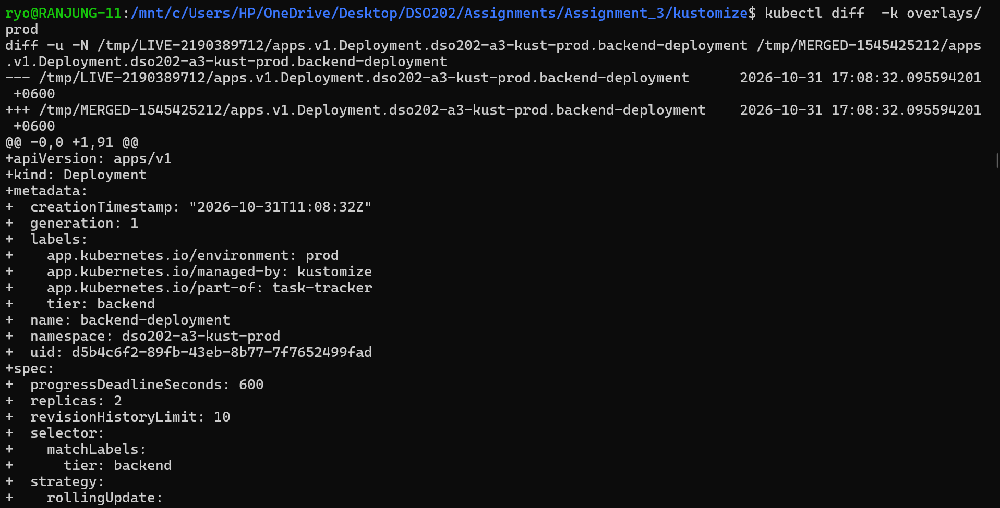

*Figure 23: Previewing prod.* Because the prod namespace was empty, `kubectl diff` shows every object as new (lines starting with `+`). For example, the backend Deployment has `replicas: 2` and the `prod` label.

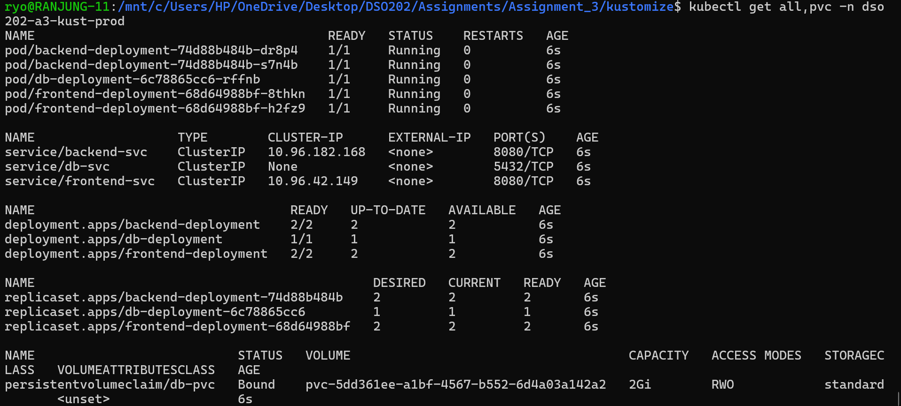

*Figure 24: Prod is running.* There are 2 backend Pods, 2 frontend Pods and 1 database Pod. The frontend Service is `ClusterIP` (no NodePort in prod), and the volume is `2Gi`.

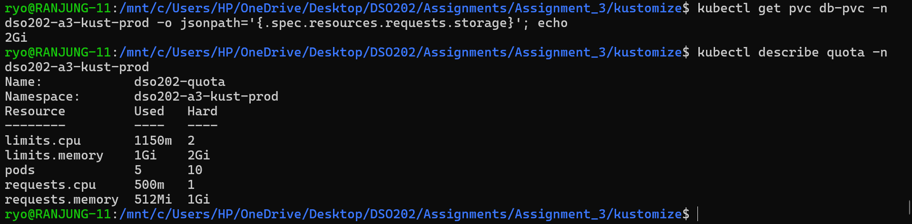

*Figure 25: Storage and quota in prod.* The JSON 6902 patch worked, and the volume is `2Gi`. The quota shows prod uses 500m of CPU requests out of 1 CPU, and 5 of 10 Pods. That leaves room for extra Pods during an update.

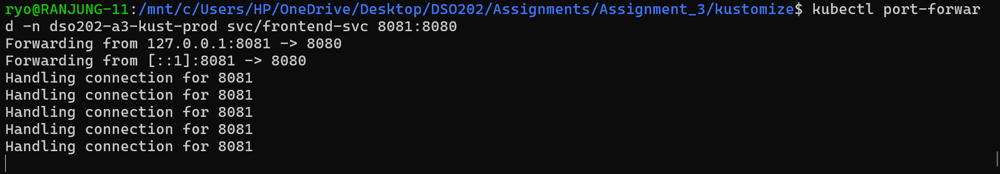

*Figure 26: Port-forwarding the prod frontend* to `localhost:8081`.

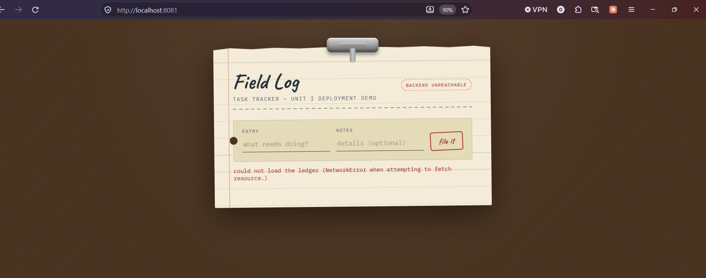

*Figure 27: The prod frontend.* The page loads, but shows **BACKEND UNREACHABLE**. This is expected. The page's JavaScript runs in my browser and tries to call `http://backend-svc:8080`. That name only works inside the cluster. My prod backend port-forward was on port 8082 (Figure 28), not 8080, so the browser had nothing to connect to. The backend is meant to stay private, so this is the correct behaviour.

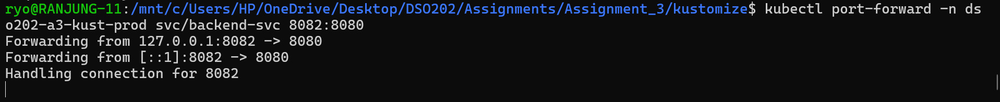

*Figure 28: Port-forwarding the prod backend* to `localhost:8082`.

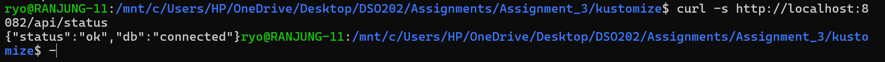

*Figure 29: Prod backend health check.* The prod backend returns `"status":"ok","db":"connected"`, so the prod app itself is healthy.

## A.10 Comparing Dev and Prod Side by Side

With both environments running, I listed the Deployments, Services and volumes in both namespaces with one `kubectl get` loop. This shows that dev and prod come from the same base but have different settings.

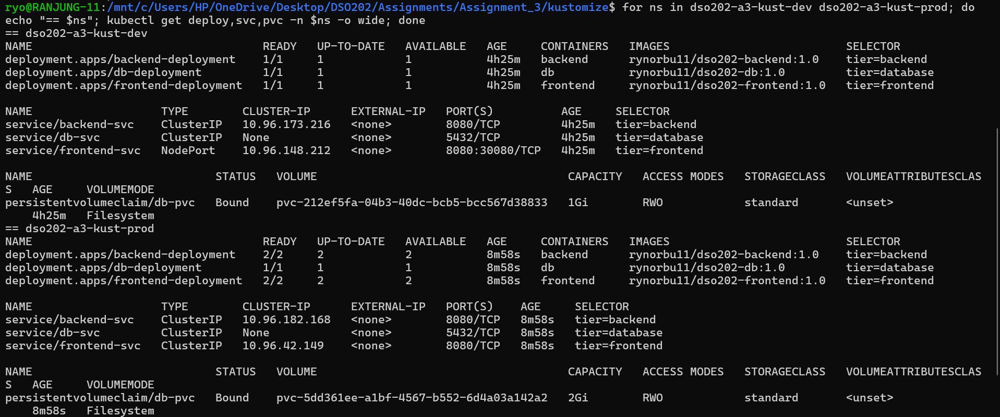

*Figure 30: Both environments together.* Dev has 1 replica of each Deployment, a NodePort frontend and a 1Gi volume. Prod has 2 backend and 2 frontend replicas, only ClusterIP Services and a 2Gi volume. Both use the same images and the same base, and only the overlay is different.

---

# Part B: Helm

## B.1 Organising the Chart

For Helm, I packaged the same Task Tracker as a chart. The chart has templates for every Kubernetes object, default settings, and separate settings files for dev and prod. I created the chart folder below and wrote each file. In Helm, the YAML files are templates with blanks such as `{{ .Values.backend.replicaCount }}`. Helm fills in the blanks from the settings, called values, and then sends the finished YAML to Kubernetes.

- `values.yaml` holds the default settings.
- `dev.yaml` and `prod.yaml` only change what is different, the same idea as Kustomize overlays.
- I gave the database user and password **no default** on purpose, so they must come from the secrets file.

## B.2 Writing the Templates

I used several Helm template features so that names stay consistent, missing settings are caught, and config changes restart the Pods. The table below lists them and what each one does in my chart.

| Feature | What it does in my chart |
|---|---|
| Name helper (`fullname`) | Names every object after the release, e.g. `tt-dev-task-tracker-backend`, so two releases never clash |
| Service-name helpers | The ConfigMap builds `DB_HOST` and `BACKEND_URL` from the **same** helper as the Service names, so they always match. (This avoids the `namePrefix` problem from Part A.) |
| `required` | Stops with a clear error message if an important value, like the password, is missing |
| `checksum/config` annotation | Stores a fingerprint of the ConfigMap in each Pod, so a config change restarts the Pods (Helm's version of the Kustomize hash) |
| `if` | Adds `nodePort:` only when the Service type is NodePort |
| `helm.sh/resource-policy: keep` | Keeps the database volume when the release is uninstalled |
| `helm.sh/hook: test` | Marks the test Pod that runs with `helm test` |

I also added **health checks** (probes). The backend is only marked "ready" when `/api/status` says the database is connected. The database is checked with `pg_isready`.

## B.3 Checking the Chart

Before installing, I checked the chart for mistakes with `helm lint` and built the YAML for dev and prod with `helm template`, using one loop for both. I also looked at the rendered ConfigMap on its own and compared the dev and prod output with `diff`.

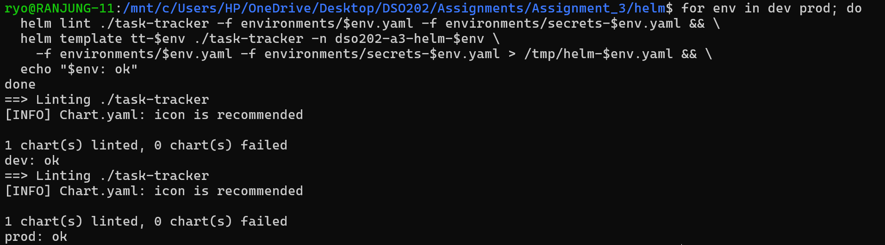

*Figure 31: Lint and render.* Both checks passed for dev and prod (`0 chart(s) failed`, `dev: ok`, `prod: ok`). The `[INFO]` line is only a suggestion to add an icon.

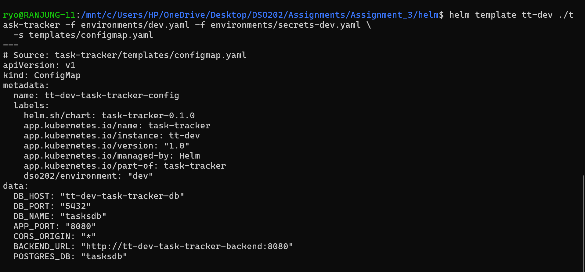

*Figure 32: One rendered template.* The ConfigMap for the `tt-dev` release. `DB_HOST` and `BACKEND_URL` were filled in automatically from the release name (`tt-dev-task-tracker-db` and `tt-dev-task-tracker-backend`), and Helm added the standard labels.

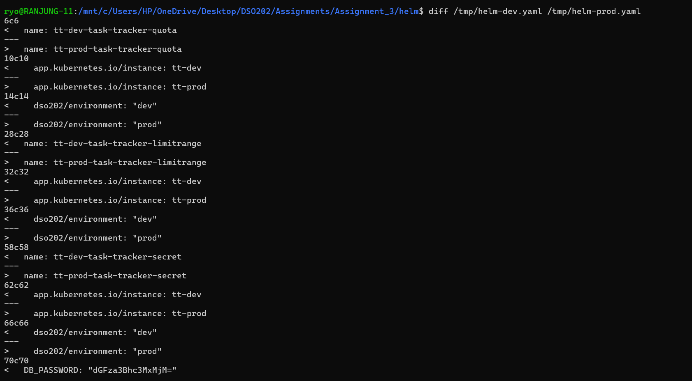

*Figure 33: Comparing dev and prod.* The differences are the names (`tt-dev-…` vs `tt-prod-…`), the environment label and the password, which comes from each environment's own secrets file.

## B.4 Stopping Bad Settings Before Deploying

I wanted to make sure the chart rejects wrong settings, so I gave it four mistakes on purpose. I left out the secrets file, left out the environment file, wrote the image tag as a number, and set an invalid NodePort. After that, I ran the strongest check, a server-side dry run with `kubectl apply --dry-run=server`.

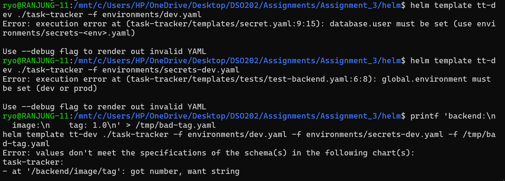

*Figure 34: Three blocked mistakes.*

1. **No secrets file:** Helm stopped with "database.user must be set".
2. **No environment file:** Helm stopped with "global.environment must be set (dev or prod)".
3. **Image tag written as `1.0` without quotes:** YAML reads this as a number, and Helm would quietly change it to `1`, giving the wrong image. My schema file caught it: "got number, want string".

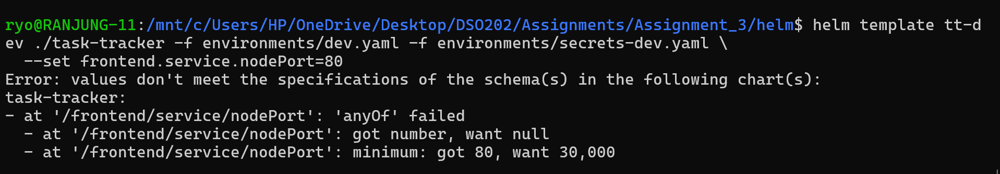

*Figure 35: Wrong port number.* Setting the NodePort to `80` was rejected, because NodePorts must be between 30000 and 32767.

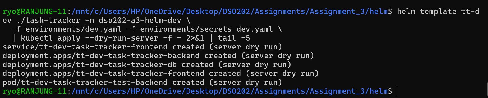

*Figure 36: Server-side dry run.* Kubernetes itself checked every object without actually creating anything. All objects passed (`created (server dry run)`).

## B.5 Installing Dev (Revision 1)

I installed the chart as a release called `tt-dev` in its own namespace with `helm upgrade --install`, using the dev settings file and the dev secrets file. Then I checked what Helm created with `helm list`, `helm status` and `kubectl get`.

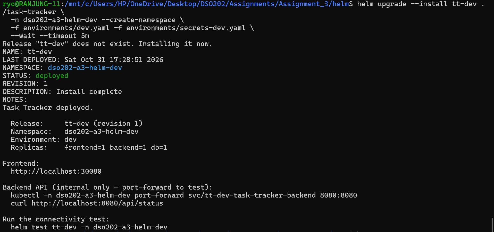

*Figure 37: Installing the dev release.* Release `tt-dev` was installed as **revision 1** with status `deployed`. The message below it comes from my `NOTES.txt`. It shows the environment, the number of replicas, the frontend address and how to test the backend.

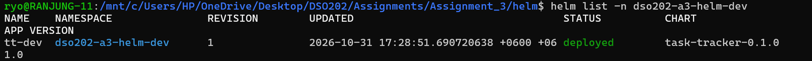

*Figure 38: `helm list`* shows the release `tt-dev`, chart `task-tracker-0.1.0`, app version `1.0`, deployed.

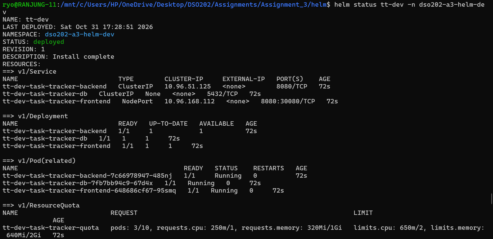

*Figure 39: `helm status`* lists everything the release created: 3 Services (the frontend is NodePort 30080), 3 Deployments, 3 running Pods and the quota.

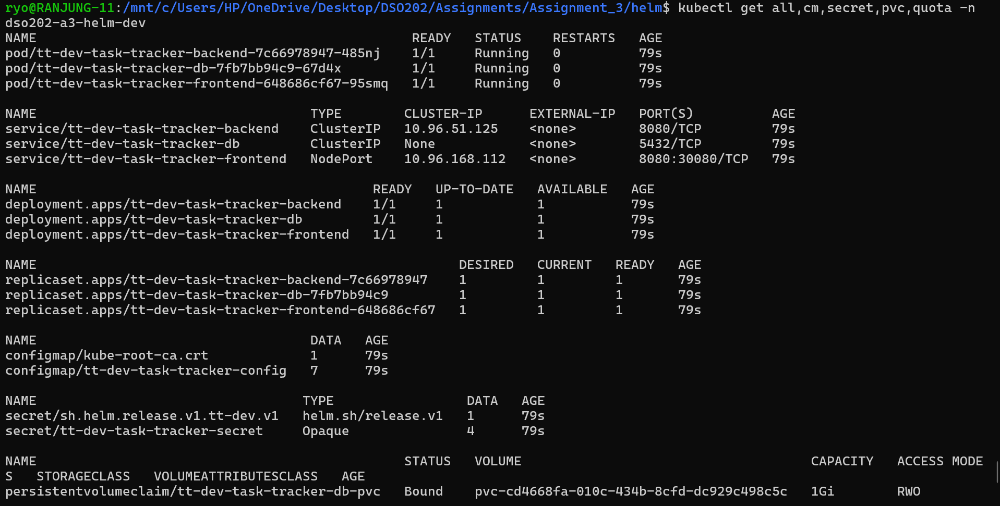

*Figure 40: The same objects from kubectl.* Every name starts with `tt-dev-task-tracker`. There is also a Secret called `sh.helm.release.v1.tt-dev.v1`. This is Helm's own record of the release.

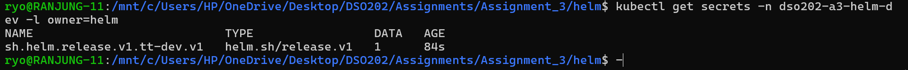

*Figure 41: Helm's release record.* Helm saves each revision as a Secret like this. This saved history is what makes `helm history` and `helm rollback` possible.

## B.6 Testing Dev

I ran the chart's built-in test with `helm test`. After that, I port-forwarded the backend to `localhost:8080` and used `curl` to check its status, add a task and list all the tasks.

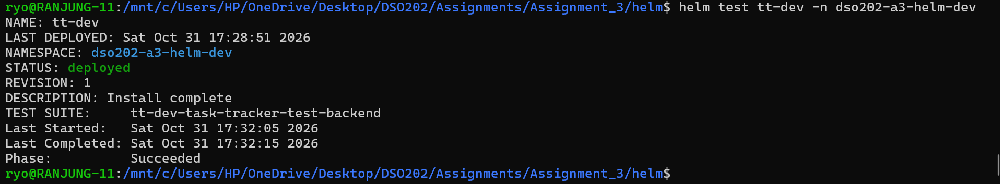

*Figure 42: `helm test`.* My test Pod called the backend's `/api/status` and checked that the database is connected. Result: **Succeeded**.

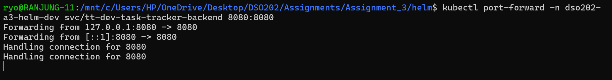

*Figure 43: Port-forwarding the Helm backend* to `localhost:8080`.

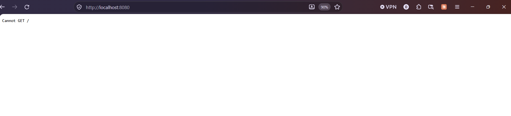

*Figure 44: Opening the backend in a browser.* `Cannot GET /` is normal. The port-forward reaches the backend API, which has no home page; its routes start with `/api/`.

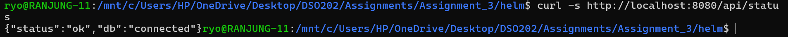

*Figure 45: Health check.* The backend reports `"db":"connected"`.

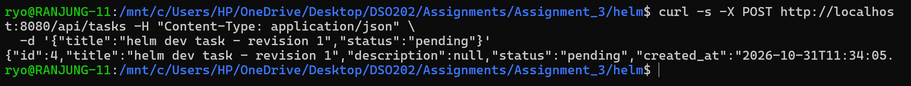

*Figure 46: Create.* I added a task called "helm dev task - revision 1". It got id 4.

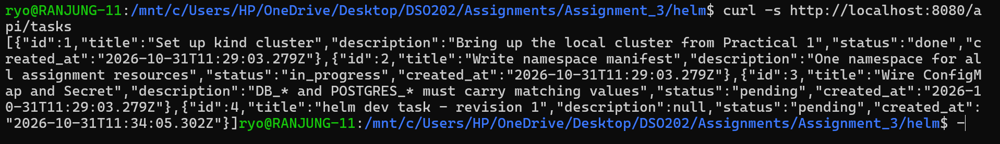

*Figure 47: Read.* The task list shows the three starting tasks and my new task #4. I used this task later to check that data survives a rollback.

## B.7 Upgrading (Revision 2)

To upgrade, I changed the dev settings to 2 backend replicas and a new `CORS_ORIGIN`. I edited `dev.yaml` and previewed the difference against the current version. Then I upgraded the release, passing both settings files again, and checked the backend Pods and the new setting inside the container.

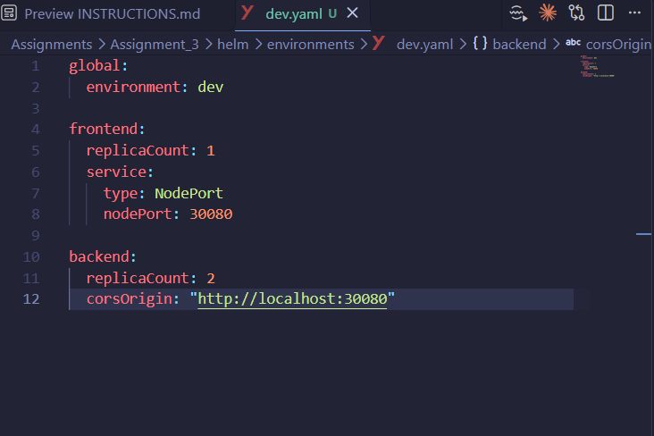

*Figure 48: The change in `dev.yaml`.* The backend now has 2 replicas, and `corsOrigin` is `http://localhost:30080`.

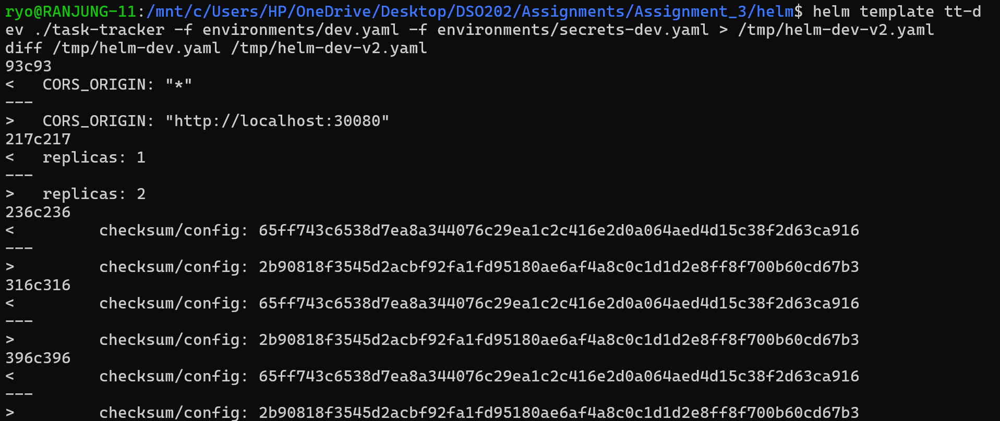

*Figure 49: Previewing the upgrade.* Three things changed: `CORS_ORIGIN`, the backend `replicas` (1 to 2), and the `checksum/config` value in every Deployment. That checksum change is what makes the Pods restart with the new settings.

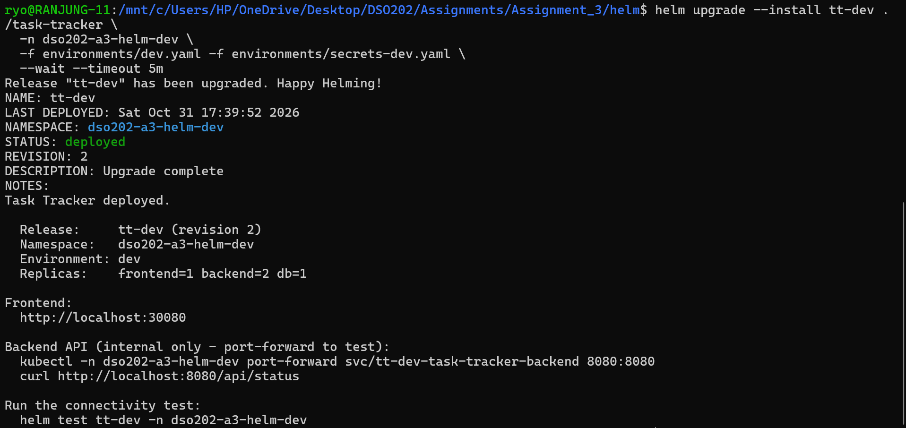

*Figure 50: The upgrade.* "Release tt-dev has been upgraded", now at **revision 2**, with `backend=2`.

*Figure 51: After the upgrade.* There are now two new backend Pods, and the running container has the new `CORS_ORIGIN` value.

## B.8 Trying a Common Upgrade Mistake

A common mistake from the lecture is upgrading with only `--set` and forgetting the settings files. I tried this by running `helm upgrade` with only `--set backend.replicaCount=3`.

*Figure 52: Upgrading with only `--set`.* Helm started again from the **default** settings and forgot my earlier ones. My chart's `required` checks stopped it with an error, so nothing broke and revision 2 kept running.

> **Lesson:** when upgrading with Helm, always pass all the `-f` settings files again.

## B.9 History and Rollback (Revision 3)

Next, I looked at the release history with `helm history` and compared the values of revisions 1 and 2. Then I rolled back to revision 1 with `helm rollback tt-dev 1`. I checked the history and Pods again, and listed the tasks to see whether my data was still there.

*Figure 53: Release history.* `helm history` shows revision 1 (install) and revision 2 (upgrade). Comparing the values shows exactly what changed between them: `corsOrigin` and `replicaCount`.

*Figure 54: Rolling back.* `helm rollback tt-dev 1` went back to the revision 1 settings. It did not delete revision 2. Instead, it created a **new revision 3** called "Rollback to 1", so the full history is kept. The backend went back to one Pod, and the extra Pod is shutting down (`Terminating`).

*Figure 55: The data is still there.* After the rollback, task #4 "helm dev task - revision 1" is still in the database. A rollback restores the Kubernetes objects, not the data inside the database.

After this, I changed `dev.yaml` back to 1 replica and `corsOrigin: "*"` so the file matches what is running.

## B.10 Installing and Testing Prod

I installed the same chart a second time as `tt-prod`, this time with the prod settings file. I listed all releases with `helm list -A` and checked the prod objects. Then I ran `helm test` and opened the frontend through a port-forward on port 8081.

*Figure 56: Installing the prod release.* The message shows `frontend=2 backend=2 db=1`. Because the prod frontend is not a NodePort, the message shows a port-forward command instead of a URL. This is the `if` in my `NOTES.txt`.

*Figure 57: Both releases.* `helm list -A` shows `tt-dev` at revision 3 (after the rollback) and `tt-prod` at revision 1. (`ranjung-argo` is my Argo CD install from class.) Prod is running 2 backend, 2 frontend and 1 database Pods, with a 2Gi volume.

*Figure 58: `helm test` on prod* also **succeeded**.

*Figure 59: The prod frontend* loads but shows "BACKEND UNREACHABLE". The reason is the same as in Figure 27: my browser cannot reach a backend that is only available inside the cluster. The test in Figure 58 shows the backend itself works.

## B.11 Security Check

I also checked how safely the database password is stored. I asked Helm for the release values with `helm get values`. Then I read the password from the Kubernetes Secret and decoded it with `base64 -d`.

*Figure 60: `helm get values`* shows the settings I gave the release, **including the database password in plain text**. Helm saves the values in its release record, so anyone who can read Secrets in this namespace can see the password.

*Figure 61: Decoding the Secret.* The password in the Kubernetes Secret is only base64-encoded, and one `base64 -d` command reveals it.

To reduce the risk, I did two things:

- The real passwords are only in `db-secret.env` and `secrets-*.yaml`. These files are listed in `.gitignore`, so they are never pushed to Git.
- I never typed the password with `--set`, so it is not saved in my shell history.

In a real project, better options would be Sealed Secrets or SOPS (which encrypt secrets stored in Git), an external secret manager, and permission rules (RBAC) that limit who can read Secrets.

## B.12 Packaging the Chart

Finally, I packaged the chart into a single versioned file with `helm package`, and read the package details back with `helm show chart`.

*Figure 62: Packaging.* The chart became one file, `task-tracker-0.1.0.tgz`, with chart version `0.1.0` and app version `1.0`. This single versioned file could be shared through a chart repository, the same way people share software packages.

---

## Kustomize vs Helm

| Point | Kustomize | Helm |
|---|---|---|
| How it works | Changes plain YAML with patches | Fills in templates with values |
| Ease of learning | Easy: my Assignment 1 files needed only small changes | Harder: template syntax, helpers, indentation |
| Installation | Built into `kubectl` | Separate tool |
| Environments | Overlay folders | Settings files (`dev.yaml`, `prod.yaml`) |
| Config change restarts Pods | Yes, using the hash in the name (Figure 22) | Yes, using the checksum annotation (Figure 49) |
| Checking bad input | Only what Kubernetes rejects | `required`, schema, lint, dry run and `helm test` (Figures 34–36, 42) |
| Version and history | None (only Git) | Chart version and revisions 1 → 2 → 3 (Figure 53) |
| Undo a change | Apply an older version from Git | `helm rollback` (Figure 54) |
| Sharing | Share the folder | Package into a `.tgz` (Figure 62) |
| Secrets | Base64 only | Base64, and also plain text in the release record (Figure 60) |

**My opinion.** Kustomize was faster and simpler for creating dev and prod versions of my own app. The base is almost the same as my Assignment 1 files. Helm took more work, but it gave me things Kustomize does not have:

- a version number for the whole app
- an undo button (rollback)
- checks that stop bad settings
- a built-in test
- a package I can share

I would use Kustomize for managing settings of my own apps, and Helm when an app needs to be versioned, upgraded, rolled back or shared with others.

---

## Reflection

This assignment helped me understand why plain `kubectl apply -f` is not enough for real projects. In Assignment 1, everything worked, but only for one environment. Adding a second environment would have meant copying and editing every file.

**Kustomize** felt natural, because I could keep writing normal Kubernetes YAML. The most useful thing I learned was the base-and-overlay idea: write the shared parts once, and keep each environment small. I was surprised that the hash in the ConfigMap name solved the "Pods don't restart after a config change" problem from Assignment 1 without any extra work. I also learned that `kubectl diff` compares with the live cluster, while `kubectl kustomize` only builds the YAML locally. I discovered this when my first diff failed because the namespace did not exist yet.

**Helm** was harder at first because of the template syntax and the indentation rules. But once the chart worked, the release features were very powerful. Seeing the history go from revision 1 to 2 to 3, and watching my task survive the rollback, made it clear that Helm manages the **Kubernetes objects**, not the **data**. The validation step was also valuable: four mistakes I made on purpose were caught before anything reached the cluster. The `--set` upgrade mistake would have caused a real problem without the `required` checks.

I also learned about security. Base64 is not encryption, and Helm keeps a plain-text copy of the values. This showed me why passwords must stay out of Git and why tools like Sealed Secrets exist.

Finally, the "backend unreachable" message in prod reminded me how Kubernetes networking works. A ClusterIP Service is only reachable inside the cluster, and a frontend that runs in the browser cannot use cluster DNS names. Next time, I would add an Ingress or an nginx proxy so the browser only talks to the frontend.

Overall, I now understand when to use each tool. Kustomize is for simple, clean configuration of my own apps. Helm is for packaging, versioning and safely upgrading apps.

---

## Conclusion

I deployed the Assignment 1 Task Tracker two more times, once with each Unit 4 tool, in separate dev and prod environments.

- With **Kustomize**, I replaced the hard-coded, copied files with one base and two small overlays. I used both kinds of patches and generated the ConfigMap and Secret. A config change now restarts the Pods automatically.
- With **Helm**, I packaged the same app as a versioned chart (`task-tracker-0.1.0`). It checks its settings before deploying, includes a test that passed in both environments, and has a full history from install to upgrade to rollback. The database data stayed safe the whole time.

Both tools produce normal Kubernetes YAML in the end. Kustomize is the simpler choice for managing settings, and Helm adds versioning, rollback, testing and sharing on top.
