# Practical 4: GitOps with Argo CD on a Kind Cluster

## Aim

To understand the **pull-based GitOps** model, install **Argo CD** on my local kind cluster, and deploy a web app straight from a GitHub repository so that Git becomes the single source of truth for my cluster.

## Objectives

- Explain the difference between push-based CI/CD and pull-based GitOps.
- Keep the Kubernetes manifests in their own Git repository.
- Install Argo CD (I used its Helm chart) and log in to the web UI.
- Write an Argo CD `Application` in YAML (declarative way).
- See the three main GitOps behaviours in action: **sync**, **self-healing** and **pruning**.
- Understand the common Argo CD states (`Synced`, `OutOfSync`, `Healthy`, `Degraded`, `Progressing`).

## What is GitOps?

**GitOps means: whatever is written in Git is what should run in the cluster.** Instead of me pushing changes into the cluster, a tool inside the cluster keeps **pulling** from Git and makes the cluster match it.

### Push vs Pull

| | Push-based CI/CD | Pull-based GitOps |
|---|---|---|
| Who deploys? | The CI tool (e.g. Jenkins, GitHub Actions) runs `kubectl apply` | An agent **inside** the cluster (Argo CD) pulls from Git |
| Cluster password | CI tool must hold admin access to the cluster | Credentials stay inside the cluster |
| After deploy | Nobody watches the cluster | Argo CD keeps watching all the time |
| Manual changes | Stay there and cause **drift** | Are found and reverted automatically |
| Rollback | Re-run an old pipeline | Just `git revert` |

### The 4 GitOps principles

1. **Declarative**: the desired state is written as YAML, not as a list of commands.
2. **Versioned**: the YAML is stored in Git, so every change has a commit, an author and a history.
3. **Pulled automatically**: an agent in the cluster fetches the changes.
4. **Continuously reconciled**: the agent keeps comparing Git with the cluster and fixes any difference.

### Key words to know

| Word | Simple meaning |
|---|---|
| **Argo CD** | A Kubernetes controller that compares Git (desired state) with the cluster (live state) and makes them the same. |
| **Application** | A custom resource (CRD) added by Argo CD. It says *which repo*, *which folder* and *which cluster/namespace*. |
| **Sync status** | `Synced` = cluster matches Git. `OutOfSync` = they are different. |
| **Health status** | `Healthy` = everything is running. `Progressing` = still starting. `Degraded` = something is failing. |
| **selfHeal** | If someone changes the cluster by hand, Argo CD puts it back to what Git says. |
| **prune** | If a file is deleted from Git, Argo CD deletes that object from the cluster too. |
| **Drift** | When the live cluster is different from what is written in Git. |

### Argo CD main parts

- **argocd-server**: the web UI and API.
- **argocd-repo-server**: clones the Git repo and reads the manifests.
- **argocd-application-controller**: compares Git with the cluster and applies changes.

By default Argo CD checks Git **every 3 minutes**. The **Refresh** button in the UI (or a webhook) makes it check right away.

### Role of kubectl in GitOps

In GitOps, `kubectl` is used only to **look and debug**. Real changes should be made through **Git commits**. If I change something with kubectl, Argo CD will treat it as drift and undo it.

---

## Procedure

### Step 1: Check the Cluster

First I checked that my kind cluster was running.


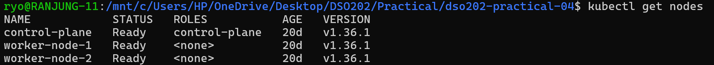

All three nodes (`control-plane`, `worker-node-1`, `worker-node-2`) are **Ready** and running Kubernetes `v1.36.1`.

---

### Step 2: Install Argo CD (using Helm)

The lab guide installs Argo CD with `kubectl apply` on the official `install.yaml`. Since I learned Helm, I chose to install it with the **official Argo Helm chart** instead. The result is the same Argo CD, but it is easier to upgrade and remove later.

#### 2.1 Add the Argo Helm repository

```bash
helm repo add ranjung-repo-argo https://argoproj.github.io/argo-helm
```

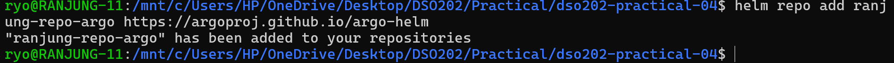

#### 2.2 Update the repository

```bash
helm repo update ranjung-repo-argo
```

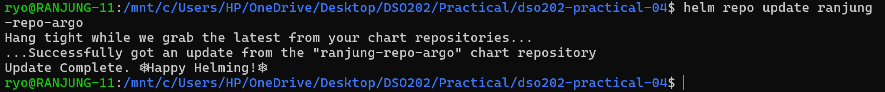

`helm repo update` downloads the latest list of charts from the repository.

#### 2.3 Check my repositories

```bash
helm repo list
```

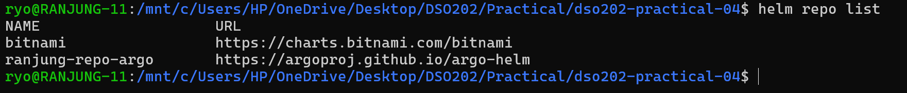

My new repo `ranjung-repo-argo` is now listed next to `bitnami`.

#### 2.4 Search the repository

```bash
helm search repo ranjung-repo-argo
```

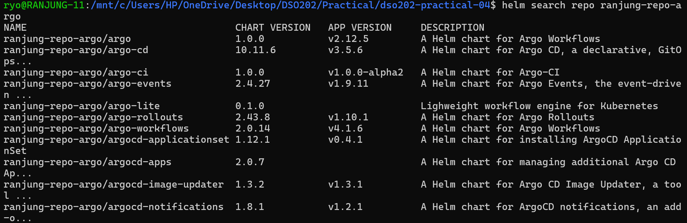

The repo has many Argo tools (Workflows, Rollouts, Events…). The one I need is **`argo-cd`**, chart version `10.11.6`, app version `v3.5.6`.

#### 2.5 Read the chart details before installing

```bash
helm show chart ranjung-repo-argo/argo-cd
```

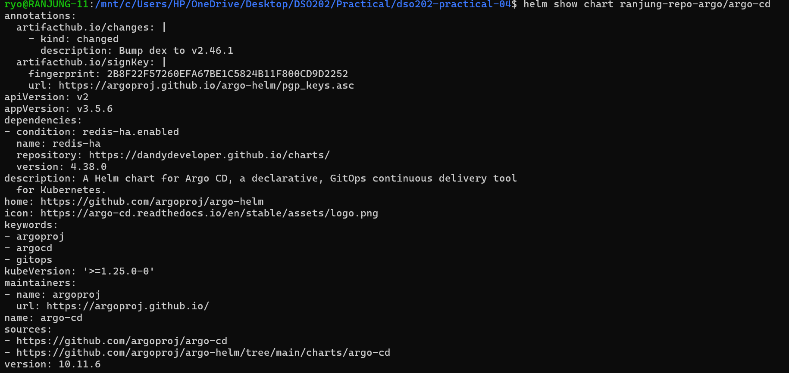

This shows the chart is maintained by `argoproj`, needs Kubernetes `>=1.25`, and has an optional `redis-ha` dependency. It is always good to read a chart before installing it.

#### 2.6 Install Argo CD

```bash
helm install ranjung-argo ranjung-repo-argo/argo-cd --namespace argocd --create-namespace
```

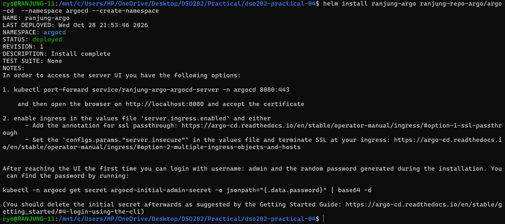

The release `ranjung-argo` was **deployed** in the `argocd` namespace. The NOTES at the end also tell me how to open the UI and how to get the admin password.

#### 2.7 Check the Argo CD pods

```bash
kubectl get deploy,svc,pods -n argocd
```

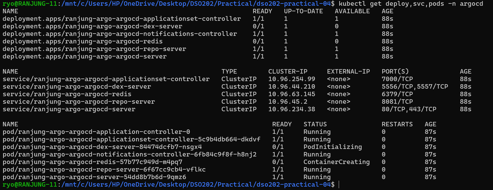

I can see all the Argo CD parts: `application-controller`, `applicationset-controller`, `dex-server`, `notifications-controller`, `redis`, `repo-server` and `server`. At this moment `dex-server` and `redis` were still starting (`PodInitializing` / `ContainerCreating`). After a short wait all pods became **Running**.

---

### Step 3: Open the Argo CD Web UI

#### 3.1 Get the admin password

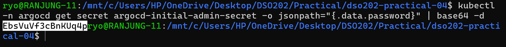

The password is stored in a Kubernetes Secret in **base64**, so I used `base64 -d` to decode it. The username is `admin`.

#### 3.2 Port-forward the Argo CD server

In a **second terminal** I kept this running:

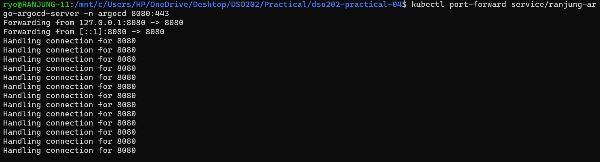

The many `Handling connection for 8080` lines show that my browser was talking to Argo CD through this tunnel.

#### 3.3 Log in

I opened `https://localhost:8080` and accepted the self-signed certificate warning (that is why the browser shows **Not Secure**).

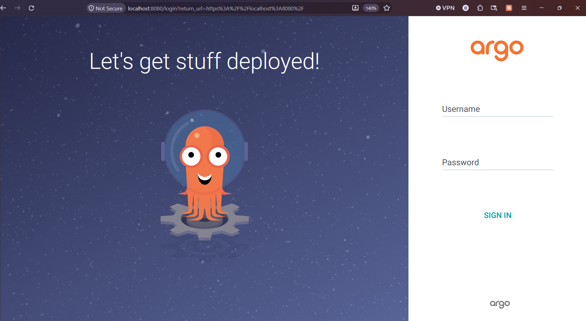

After logging in as `admin`, I saw the empty Applications page:

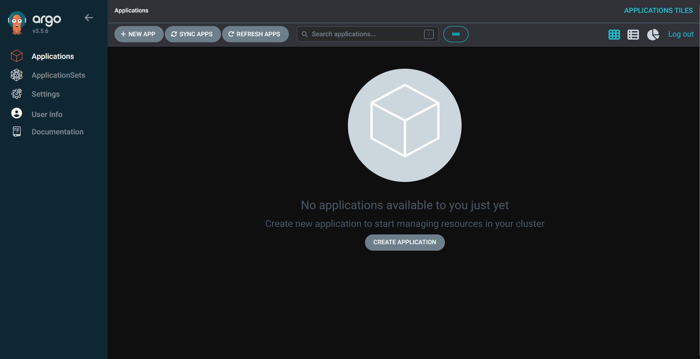

"No applications available to you just yet" this is correct because I have not created any app yet.

---

### Step 4: Create the Git Repository (Desired State)

I created a **public** GitHub repository called `dso202-gitops-demo` and cloned it. Inside it, I made a `manifests/` folder with two files:

- **manifests/deployment.yaml**: a Deployment named `webapp-deploy` with **2 replicas**, image `nginxdemos/hello:plain-text`, port 80.

- **manifests/service.yaml**: a ClusterIP Service named `webapp-svc` that selects `app: webapp` on port 80.

Then I pushed it to GitHub.

This repo only has **Kubernetes manifests**, not app source code. Keeping config separate from code avoids CI loops and gives a clean history of what was deployed and when.

---

### Step 5: Create the Argo CD Application

I wrote `argocd-app.yaml`. It answers three questions: **where is the desired state**, **where to deploy it**, and **how to sync it**.

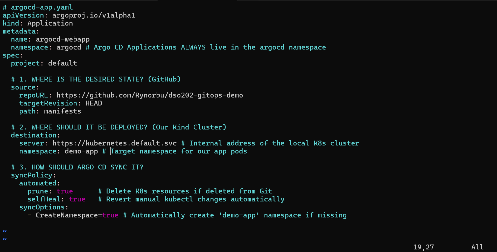

- **source**: my GitHub repo, `HEAD` of the branch, folder `manifests`.
- **destination**: the same cluster (`https://kubernetes.default.svc`), namespace `demo-app`.
- **syncPolicy.automated**: `prune: true` and `selfHeal: true`.
- **CreateNamespace=true**: Argo CD creates `demo-app` for me if it does not exist.

Then I applied it. This is the **only** `kubectl apply` I needed in the whole practical, after this, Git controls everything.

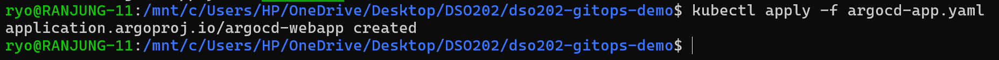

In the UI, the app `argocd-webapp` appeared and synced automatically:

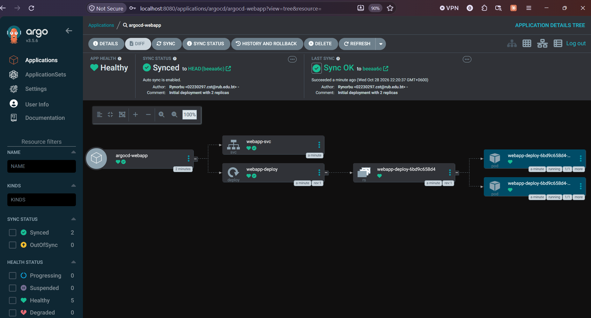

- **App Health:** Healthy
- **Sync Status:** `Synced` to `HEAD (beeaa6c)`, with my commit message *"Initial deployment with 2 replicas"*.
- The tree shows: Application - Service `webapp-svc` and Deployment `webapp-deploy` - ReplicaSet - **2 Pods**.

I also checked from the terminal.

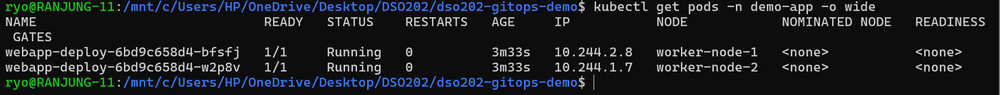

Both pods are **Running**, one on `worker-node-1` and one on `worker-node-2`. Kubernetes spread them across the workers.

---

### Experiment 1: Scale the App Through Git

Instead of using `kubectl scale`, I changed the number of replicas **in Git**.

I edited `manifests/deployment.yaml` and changed `replicas: 2` to `replicas: 4`:

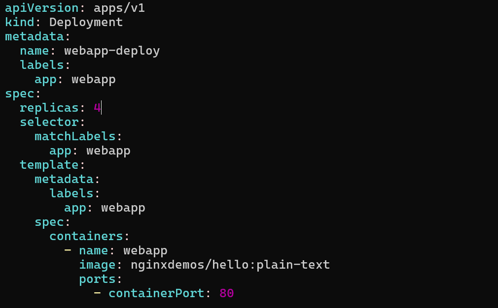

Then updated in git. I clicked **Refresh** in the UI:

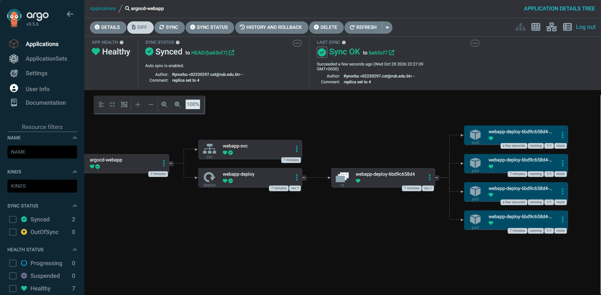

Argo CD synced to the new commit `ba65cf7` ("replica set to 4") and now there are **4 pods**. Two of them are "a few seconds" old, these are the new ones Argo CD created. The two old pods (7 minutes) were not touched.

**Result:** A simple Git commit changed my running app. I did not run any `kubectl` command.

---

### Experiment 2: Drift and Self-Healing

Now I tried to **break** the desired state on purpose by changing the cluster by hand.

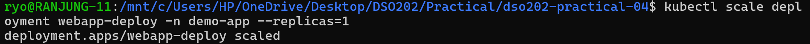

In another terminal I was watching the Deployment.

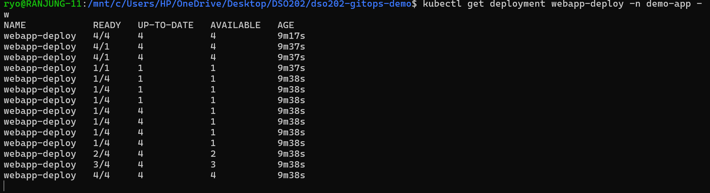

**What happened (line by line):**

1. 4/4 – normal state from Git.
2. 4/1 - 1/1 – my kubectl command reduced it to 1 pod. The app became **OutOfSync** for a moment.
3. 1/4 – within about **1 second**, Argo CD noticed the drift and set replicas back to 4.
4. 2/4 - 3/4 - 4/4 – new pods started until all 4 were ready again.

**Result:** Because `selfHeal: true` is on, Argo CD undid my manual change almost immediately. Git (4 replicas) won over kubectl (1 replica). This shows why, in GitOps, changes must go through Git.

---

### Experiment 3: Pruning

Next I removed the Service from Git.

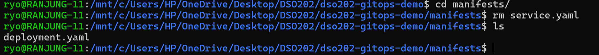

Only `deployment.yaml` is left. Then I committed and pushed to the git.

After clicking **Refresh**:

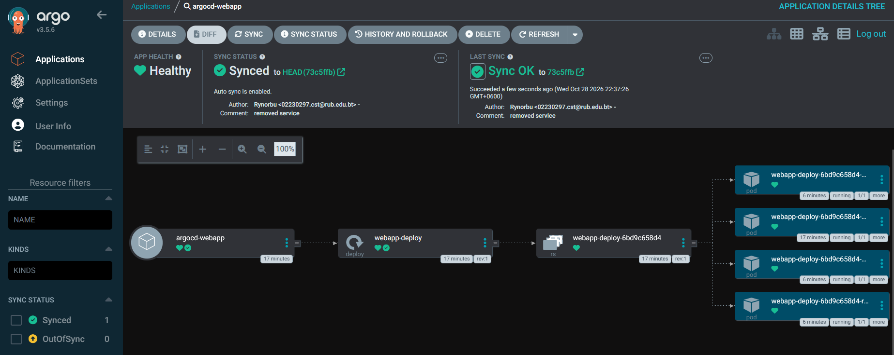

Argo CD synced to commit `73c5ffb` ("removed service") and `webapp-svc` is **gone** from the tree. Only the Deployment, ReplicaSet and 4 Pods remain. The Synced count also changed from 2 to 1 resource.

**Result:** Because `prune: true` is on, deleting a file in Git also deleted the object in the cluster. Without prune, the old Service would stay behind as an "orphan". To bring it back I could simply run `git revert HEAD` and push.

---

## Reflection

### What I learned

Before this practical, I deployed everything with `kubectl apply` and then I had to remember what I changed. Now I understand a completely different way of working: **Git is the boss, and Argo CD makes the cluster obey Git.** I learned that Argo CD is just another Kubernetes controller, it runs the same "watch and fix" loop as a Deployment controller, but it compares Git with the cluster. I also learned how the `Application` resource connects a repo, a folder and a namespace together, and what `prune` and `selfHeal` really do.

### Overall

This practical was really interesting, especially the self-healing part. Seeing my manual change get undone in one second made me understand why GitOps is so powerful: the cluster cannot slowly "drift" away from what is written in Git.

---

## Conclusion

In this practical I set up a complete GitOps workflow. I installed Argo CD using its Helm chart, logged in to the web UI, created a GitHub repository with my Kubernetes manifests, and connected it to the cluster using an Argo CD `Application`. Then I proved the three main GitOps behaviours: **scaling through a Git commit** (2 → 4 replicas), **self-healing** (my manual scale to 1 was reverted to 4 in about a second), and **pruning** (deleting `service.yaml` from Git removed the Service from the cluster). The main lesson is: **in GitOps, Git is the single source of truth, we change Git, not the cluster, and Argo CD makes sure the cluster always matches.**
